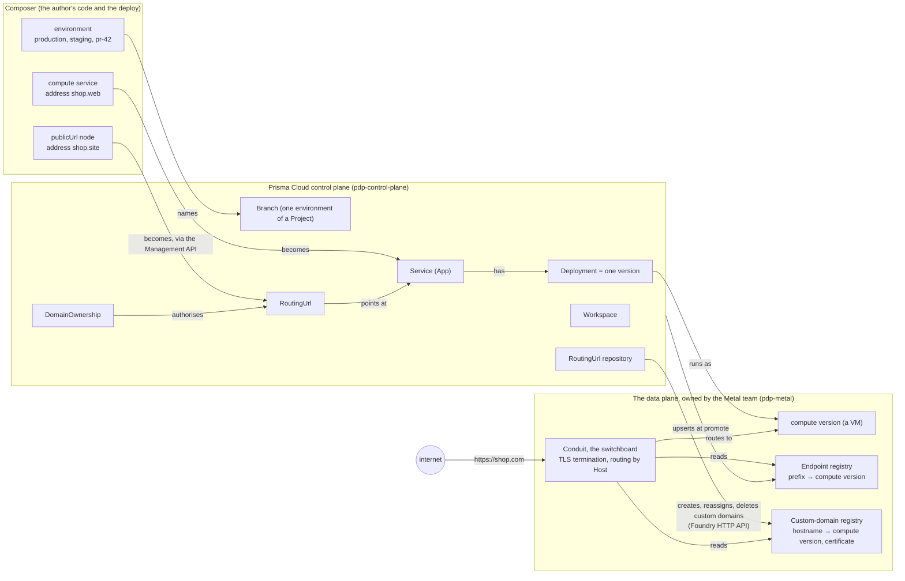
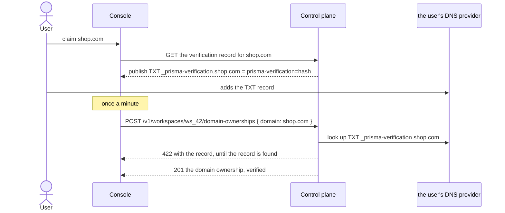
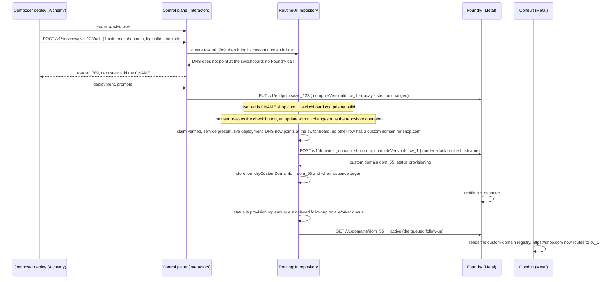
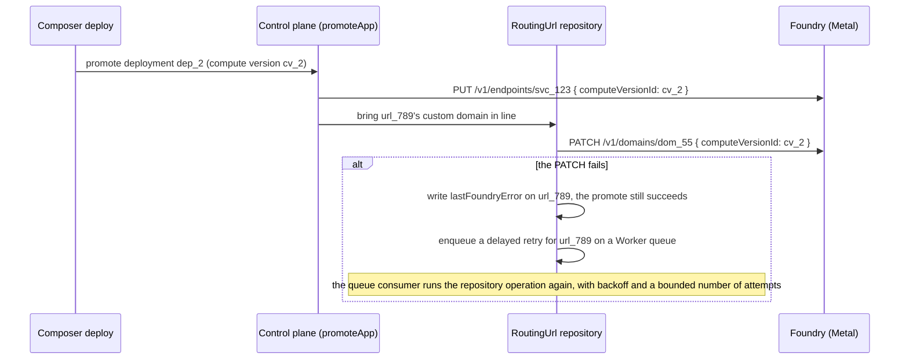

# Public URLs

## The problem

A Composer application is a topology: the services, databases and buckets an author declares in code, and the connections between them. The one thing an author cannot declare today is how the application is reached from the internet. Every service gets an address the platform chooses, whether the author wants it reachable or not. A hostname of the author's own, such as `shop.com`, can only be attached afterwards, by hand in the Console, and only once its DNS already points at the platform. Nothing in the code says which services are public or at which hostname, so the topology is incomplete, the hostname is not reproduced when the app is deployed to another environment, and a deploy cannot set it up.

Authors need to declare their ingress URLs as part of the application topology, per environment, and have the deploy make them real.

## An example

An author has a shop with a web service. They want it at `shop.com` in production, at `staging.shop.com` in staging, and at whatever address the platform gives it in every preview. They write this:

```ts
import { module, resolve } from '@prisma/composer';
import { publicUrl } from '@prisma/composer-prisma-cloud';

export default module('shop', ({ environment, provision }) => {
  const web = provision(webService);

  const url = resolve([environment.name], ([name]) =>
    name === 'production' ? 'shop.com'
    : name === 'staging' ? 'staging.shop.com'
    : publicUrl.prismaBuild());

  provision(publicUrl({ name: 'site', url, target: web.http }));
});
```

They run `prisma deploy`. The deploy creates the service, and it creates a record on the platform saying that `shop.com` should reach it. Nobody has set up DNS for `shop.com` yet, and the deploy does not fail. Its output says:

```
shop.site   shop.com   waiting for DNS
            Add a CNAME record from shop.com to switchboard.cdg.prisma.build
            https://console.prisma.io/…/compute/svc_123/domains?setup=shop.com
```

The author adds the CNAME at their DNS provider and presses the check button next to `shop.com` in the Console. The platform sees that DNS is right and creates the custom domain in the routing layer. The certificate takes a minute to issue, and the platform follows that up by itself; then `shop.com` serves the shop. Nobody redeployed anything, and nobody pressed anything twice.

A month later the author deletes the `web` service and deploys a new one under the same name. The record for `shop.com` is still there, its DNS still points at the platform, and the new deploy points it at the new service. `shop.com` keeps working.

That is the whole proposal. The rest of this document explains the parts that make it work.

## The three domains

Three systems take part, and each has its own vocabulary.



**Composer**, owned by the Terminal team with the ORM, is where the author describes the application as a graph of nodes: services, databases, and now public URLs. Every node has an address, such as `shop.site`, and the deploy writes that address onto the platform record that represents the node, as its `logicalId`. Composer talks to the control plane through its Management API, using the upstream Alchemy provider as the deploy engine.

**The control plane**, owned by the Portal team, is Prisma Cloud's product model: a Workspace owns Projects, a Project has Branches, a Branch is one environment of one application and holds its services. A service (still called `App` in the code) has Deployments, and one of them is live. This proposal adds two records here, RoutingUrl and DomainOwnership, with interactors to write them, and gives the RoutingUrl repository the job of keeping Foundry consistent with each row. The control plane talks to Metal through Foundry's HTTP API.

**The data plane** is the set of systems below the control plane that run the users' workloads and carry their traffic: Foundry, Conduit, the Prisma Postgres infrastructure and the rest of the pdp-metal repository. The Metal team owns it. For public URLs two of its systems matter. **Foundry** runs each deployment as a compute version, a VM, and owns two registries in a shared database: the endpoint registry, which maps a `prisma.build` prefix to a compute version, and the custom-domain registry, which maps a customer hostname to a compute version and holds its certificate state. **Conduit** is the regional edge, reached at `switchboard.<region>.prisma.build`. It terminates TLS and routes every request by its Host header, reading both registries. Foundry is the only writer of the registries and Conduit only reads them. Nothing in Metal changes in this proposal.

The lines that matter: Composer never talks to Metal. The control plane is the only thing that writes to Foundry: the RoutingUrl repository for custom domains, and the existing promote step for endpoints. Metal knows nothing about workspaces, services or ownership; it knows hostnames, compute versions and certificates.

## The concepts, one at a time

### A hostname a service answers at

Every service already has one hostname: its endpoint, `<service id>.<region>.prisma.build`. The control plane creates it in Foundry's endpoint registry when the first version is promoted, and re-points it at each new live version. The author never asks for it. This proposal leaves it exactly as it is.

A **custom hostname** such as `shop.com` is what this proposal is about. Today it exists only as a custom domain in Foundry's registry, bound to one compute version, and the control plane keeps no record of it.

### The RoutingUrl

A RoutingUrl is the control plane's record that a custom hostname should reach a service. It has the hostname, the service it reaches, the Branch that owns it, a `logicalId` that a deploy tool can write so it can find the record again, and, once the control plane has created one, the id of its Foundry custom domain. It exists from the moment it is created, before DNS, before any certificate, before Foundry has heard of the hostname. The Branch owns its lifetime: deleting the Branch deletes it, but deleting the service only detaches it.

### The domain ownership claim and its verification

A DomainOwnership record is a workspace's claim that it controls a domain: either an exact hostname such as `shop.com`, or a wildcard one label deep such as `*.preview.shop.com`. It exists only once the platform has seen a TXT record at `_prisma-verification.shop.com` carrying a value derived from the workspace's id; there is no unverified claim. This is the same TXT record the platform asks for today; a workspace that has published it once needs nothing new.

Ownership and routing are separate questions. Ownership asks whether this workspace may use this domain. Routing asks which service a hostname reaches. A RoutingUrl can exist without a verified claim; it just cannot serve traffic until one exists.

### The six conditions

A RoutingUrl serves traffic only when all six of these are true:

1. The workspace has a verified claim covering the hostname.
2. The service exists.
3. The service has a live version.
4. The hostname's DNS points at the regional switchboard.
5. A Foundry custom domain exists for the hostname, this RoutingUrl holds its id, and it is bound to the live deployment's compute version.
6. Foundry reports the custom domain's certificate as active.

There is deliberately no single status field. Each condition changes on its own: a certificate can be issuing while the service is deleted; a CNAME can be removed years later. The record reports all six, and reports the first unmet one as the next thing to do, with the exact DNS record to publish.

### One custom domain per hostname

Any number of RoutingUrls may name the same hostname, in any workspaces. Only one of them at a time may have a Foundry custom domain, otherwise two services would receive the same traffic. The control plane enforces this with a unique index over the rows that have one, and takes a database lock on the hostname while it creates one, so the rule holds across every workspace and region. A RoutingUrl that cannot get the custom domain reports which workspace, project and service have it, to a caller allowed to see that workspace, and otherwise says only that another workspace holds the hostname.

### How the control plane keeps Foundry consistent

The RoutingUrl repository has one operation that looks at a row, evaluates its six conditions, and makes the Foundry call the row needs. It creates the custom domain when the first four conditions hold and no other row has one for the hostname. It reassigns the custom domain to the new compute version when the live deployment changes. It creates the custom domain again when Foundry has deleted it with its compute version. It moves a custom domain from one RoutingUrl to another when a row is replaced by one for the same hostname and service, so that a certificate is never reissued for a change that leaves the routing table the same. When Foundry reports the custom domain failed for a DNS reason and DNS is now right, it asks Foundry to retry.

Every interactor that writes a RoutingUrl, and every lifecycle interactor that changes a service's live deployment or deletes a service or Branch, calls that operation for the rows it affects, in the request. When a Foundry call fails, or leaves the custom domain waiting for its certificate, the operation enqueues a delayed follow-up for the row on a Worker queue, and the consumer runs the same operation again, with backoff and a bounded number of attempts after a failure, and at a fixed interval for as long as a certificate can take to issue, so a failed reassign at promote repairs itself and a certificate completes without the user pressing anything twice. When a row's custom domain is deleted, the operation also runs for every other row naming that hostname. The two facts that complete a row, the user's DNS and Foundry's certificate, change without telling the control plane; they are looked up whenever the operation runs, and the user can run it with the check button in the Console. A cron that runs it for every row not yet serving, so the button is never needed, is a stretch goal at the end of the project.

## The key operations and what reaches Metal

### Claiming and verifying a domain



Nothing reaches Metal. Verification is entirely a control-plane matter. If another workspace later claims a domain that this claim covers, the control plane re-verifies this claim first and deletes it if its record is gone, so a workspace that no longer controls a domain loses its standing at the moment it matters.

### Creating a RoutingUrl from a deploy, and getting it to serve



What crosses into Metal is one call to create a custom domain for the hostname against a compute version id, and reads of that custom domain's status. The hostname, the compute version id and nothing else: Metal never learns about the service, the Branch, the workspace or the claim.

### A new version goes live



The lifecycle events that matter are: a deployment promoted or a service rolled back (the live deployment changes), the live deployment stopped (no deployment is live; the custom domain stays bound to the stopped compute version and the row reports it as unmet), the live deployment deleted (Foundry deletes the custom domain with the compute version; the control plane clears the id and creates the custom domain again when a deployment is live), the service deleted (the RoutingUrl is detached and its custom domain deleted), and the Branch deleted (the RoutingUrl is deleted with its custom domain). Each of those interactors calls the repository operation for the rows it affects, and any failure is written on the row.

### A deploy tool taking over a row it did not create

When a deploy declares a RoutingUrl and no row on the Branch carries the node's `logicalId`, the Alchemy resource looks for a live row on the same service with the same hostname and no `logicalId`. If there is one, it writes the `logicalId` on that row and treats the row as its own from then on. This is called adoption. It is how a hostname the user attached in the Console before this work, which the platform migrates into a RoutingUrl with no `logicalId`, becomes the node's row with no interruption and no new certificate. The control plane does nothing special for it; it only allows the `logicalId` to be set on an update.

## Scenarios

**Deploying an app for the first time, with a custom hostname.** The deploy creates the service and the RoutingUrl and succeeds. The output says what `shop.com` is waiting for and prints every record still to publish: the ownership TXT record if the workspace holds no verified claim for `shop.com`, and the CNAME, each with name, type and value. The user publishes them and presses check in the Console; the platform finds the TXT record and creates the workspace's claim, verified, creates the custom domain, follows up the certificate on its own, and the hostname serves. A user who claimed `shop.com` in the Console beforehand sees only the CNAME. Either order works.

**Deploying a code change, with no downtime.** The deploy creates a new deployment and promotes it. Promote re-points the endpoint and reassigns the custom domain to the new compute version. If the reassign fails, the failure is written on the RoutingUrl and a queued retry repairs it without anyone acting. The hostname, the certificate and the DNS are untouched throughout.

**A preview environment.** `prisma deploy --environment pr-42` deploys into a new Branch. The code's `resolve()` returns `publicUrl.prismaBuild()` for it, so no RoutingUrl is created and the service is reached at its `prisma.build` endpoint. If the code instead names `pr-42.preview.shop.com`, one claim for `*.preview.shop.com` and one wildcard CNAME at the user's DNS provider cover every preview, and each preview hostname gets its own certificate when its custom domain is created.

**Adding a custom hostname to a running app.** The author adds a `publicUrl()` node and deploys. The RoutingUrl is created, the service keeps serving at its endpoint, and the new hostname goes live once the user has done the DNS and claim steps and pressed check.

**Changing a hostname.** The author changes `'shop.com'` to `'theshop.com'`. The node keeps its address, so the same RoutingUrl is updated. The old hostname's custom domain is deleted and the new hostname goes through the six conditions.

**Deleting and recreating a service.** The RoutingUrl stays with `appId` null and its custom domain deleted. The next deploy that declares the hostname on a service points the row at it, and the hostname serves again without any DNS change.

**Removing a public URL.** The author deletes the `publicUrl()` line. The deploy deletes the RoutingUrl and its Foundry custom domain. The service keeps its endpoint, and the ownership claim is untouched.

**A hostname set up in the Console last year, now declared in code.** The migrated RoutingUrl has the hostname, the service, and no `logicalId`. The deploy adopts it. Nothing in Foundry changes.

**Two workspaces name the same hostname.** Both RoutingUrls exist. Whichever meets its conditions first gets the custom domain. The other reports the hostname as held, and names the holder if the caller may see that workspace. When the holder is deleted, the platform runs the check for every other row naming that hostname, so the other gets a custom domain without anyone acting.

## The second step

In this first step every service is still reachable at its `prisma.build` endpoint whether or not the code says so, and `publicUrl.prismaBuild()` creates no record. The second step makes the endpoint a RoutingUrl too, created only when something asks for it, so that a service nothing should reach from outside has no public hostname at all. `publicUrl.prismaBuild()` then creates that record, and adoption takes over the records the platform migrates for existing services. The twelve scenarios that step must satisfy are in [step-two-migration-scenarios.md](step-two-migration-scenarios.md).

## Not in this proposal

Private routing between services. Routing by path. Any change to Foundry or Conduit. Re-checking DNS or ownership for a hostname that already serves.

## Where the detail is

Composer:

- [ADR-0060](../../../../docs/design/90-decisions/ADR-0060-public-traffic-reaches-a-service-through-a-public-url.md): the public URL node, and the alternatives considered.
- [ADR-0062](../../../../docs/design/90-decisions/ADR-0062-environment-values-come-from-resolve-and-config-adapters.md): `resolve()`, environments and config adapters.
- [ADR-0061](../../../../docs/design/90-decisions/ADR-0061-a-module-declares-its-input-as-a-compute-service-does.md): module input, a follow-on project.
- [composer-to-platform.md](composer-to-platform.md): how a node becomes a platform record. [scenarios.md](scenarios.md): thirteen worked scenarios with code and records. [domain-map.md](domain-map.md): every entity in each system.
- The project's spec and plan: [`.drive/projects/public-urls/`](../).

Prisma Cloud (the platform team maintains these in prisma/pdp-control-plane under `docs/compute/`, on the branch of prisma/pdp-control-plane#5795):

- [platform-routing-urls.md](platform-routing-urls.md): the two records column by column, the conditions, the rules, the routes, the Console and the migration of existing domains.
- [platform-routing-url-lifecycle.md](platform-routing-url-lifecycle.md): every operation and lifecycle event, what each changes, what reaches Foundry, and the repository operation's steps.
- [The proposal for keeping the data plane consistent with the control plane](https://github.com/prisma/pdp-control-plane/blob/chore/adr-ingress-entity/docs/data-plane-consistency/README.md): the overview, with the RoutingUrl worked through as its example, the prior art, and the surveys of every place the control plane writes to Foundry, Tenant Manager and Tigris today.
- [ADR 015](https://github.com/prisma/pdp-control-plane/blob/chore/adr-ingress-entity/docs/architecture/adrs/ADR-015-routing-urls-and-domain-ownership.md): the decision, why, and the alternatives.
- [projects/routing-urls](https://github.com/prisma/pdp-control-plane/tree/chore/adr-ingress-entity/projects/routing-urls): the spec, the acceptance criteria and the five-slice plan.

Metal, for reference: [Foundry's API](https://github.com/prisma/pdp-metal/blob/main/apps/foundry/docs/API_SPEC.md) and the [custom-domain contract between Foundry and Conduit](https://github.com/prisma/pdp-metal/blob/main/docs/custom-domains.md).
