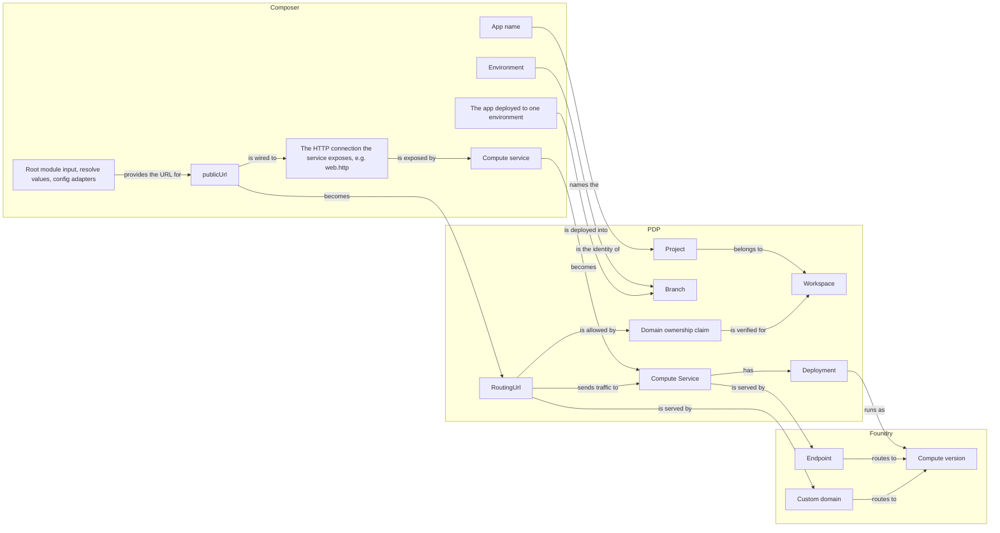

# Domain map: public URLs in Composer, PDP and Foundry

Working draft. It lists the things each system models, what each one is, and how the three systems correspond. Entities that don't exist yet are marked as new in the tables.

## Foundry: runs code and routes traffic to it

| Entity | What it is |
| --- | --- |
| **Compute version** (`cv_…`) | One copy of a service's code that Foundry can start, stop and report on. Foundry has no idea of a service; every other Foundry record points at a compute version. |
| **Endpoint** | A record that sends traffic for one `*.prisma.build` hostname to one compute version. PDP creates one per service, named after the service's id, and points it at the newly live compute version on every promote. |
| **Custom domain** (`dom_…`) | A record that sends traffic for one hostname, such as `www.example.com`, to one compute version, with the state of its certificate. Foundry only creates it if the hostname's DNS already points at Foundry. Deleting the compute version deletes the record. |

## PDP: the product's model

Exists today:

| Entity | What it is |
| --- | --- |
| **Project** | One application. Composer finds it by its `logicalId`. |
| **Branch** | One environment of one Project, so one app in one environment. It holds that environment's services, databases, buckets, configuration and deploy state. Every Project has one default Branch, created as `main`. |
| **Compute Service** (labelled App in PDP's code, API and Console) | A deployed service. It knows its `*.prisma.build` hostname and which of its deployments is live. |
| **Deployment** | One deployed copy of a service's code. It records which Foundry compute version runs it. Composer only creates a new one when the service's code or configuration changed. |
| **Build**, **Promotion** | One deploy run, and the moment a deployment became live. |
| **Database**, **Bucket**, **ConfigVariable** | Data, file storage, and per-Branch configuration values. |
| **ApplicationTopology** | A record, written on each deploy, of the graph that deploy declared. It is for display only; nothing is deployed from it. |

PDP has no record of custom domains today. They exist only in Foundry. To add one, the user must publish a TXT record proving they own the hostname (prisma/pdp-control-plane#5785) and point the hostname's DNS at Foundry. Every service also gets a `*.prisma.build` endpoint at promote whether anyone asked or not.

New:

| Entity | What it is |
| --- | --- |
| **RoutingUrl** | A custom hostname mapped to a service, whichever of the service's deployments is live. It exists as soon as it's declared and calls no Foundry API on creation. It receives traffic once all of its conditions hold (ownership verified, service present, live deployment, DNS pointing at the switchboard, custom domain bound, certificate active); until then the deploy still succeeds and the record shows the first unmet condition. The RoutingUrl repository keeps its Foundry custom domain bound to the live deployment. It survives its service being deleted. Composer finds it by its `logicalId`. A hostname serves one RoutingUrl on the whole platform. Nothing is created unless something asked for it. |
| **Domain ownership claim** | A workspace's claim to a domain, verified or not: an exact hostname or an exact wildcard covering one label. Verification is today's check, unchanged: the user publishes a TXT record at `_prisma-verification.<domain>` carrying a value specific to their workspace (prisma/pdp-control-plane#5785), so the claim belongs to the workspace and is shared by every project in it. The user verifies on the platform; Composer has no part in it. A RoutingUrl starts receiving traffic once its hostname is covered by a verified claim. |

## Composer: how authors describe the app

| Entity | What it is |
| --- | --- |
| **App name** | The root module's name. It identifies the app in every environment, and it is the Project's `logicalId`. |
| **The app, deployed to one environment** | Everything under the root module, deployed into one environment. There is one of these per environment, so it is not the Project. |
| **Environment** (renamed from stage) | A place the app runs, such as `production`, `staging`, `pr-42`, or `dev` on your machine. Every environment has a name. `prisma deploy` uses `production` unless told otherwise; `prisma dev` uses `dev`. |
| **Compute service** and its **exposed HTTP connection** | A service, and the HTTP connection it offers to the rest of the graph with `expose: { http: rawHttpContract }`. Anything wired to that connection can send HTTP requests to the service. Other code refers to it as `web.http`. |
| **Node address** | A node's identity, such as `shop.site`. Composer writes it as the `logicalId` of the node's platform record. |
| **publicUrl** (new) | `publicUrl({ name, url, target })` sends public traffic to one service. `target` is wired to the HTTP connection the service exposes, which is how the URL knows which service receives its requests. `url` either names the hostname to use or says the service is public at the hostname the platform gives it. It can differ per environment or derive from an input: `url` may be a `resolve()` value, computed after the graph is built from its listed dependencies: inputs, deploy-time references such as `environment.name`, other resolved values. |
| **Root module input** and **config adapters** (new) | Every module declares its inputs with one schema. The root module's inputs are filled by adapters listed in `prisma.config.ts`, for the environment being deployed. |

## How they correspond

| Composer | PDP | Foundry |
| --- | --- | --- |
| App name | the Project, as its `logicalId` | — |
| The app, deployed to one environment | that environment's Branch | — |
| A deploy to `production` | goes into the Project's default Branch (created as `main`) | — |
| A deploy to any other environment, such as `staging` | goes into the Branch named `staging`, which is created if it doesn't exist | — |
| A run of `prisma dev` | nothing; it runs on your machine | nothing |
| Compute service | a Compute Service with its `*.prisma.build` hostname, with a new Deployment whenever its code or configuration changed | one compute version per Deployment, and the service's Endpoint |
| `publicUrl` with a prisma.build URL | nothing; the service's existing `*.prisma.build` hostname is reported | the service's Endpoint |
| `publicUrl` with a named hostname | a RoutingUrl that needs a verified domain ownership claim | a Custom domain |
| Root module input and config adapters | nothing; Composer works out their values before deploying | nothing |

Each time a deployment goes live, PDP reassigns the Foundry custom domain behind every RoutingUrl to that deployment's compute version, and a queued retry repairs any that promote missed.

## A hostname is served by only one RoutingUrl

If two RoutingUrls for the same hostname were both registered, traffic would go to whichever one Foundry's records happened to match. So at most one RoutingUrl is registered for a hostname on the whole platform, across every workspace, project and environment. This rule is unrelated to ownership.

Any number of records may name the hostname; PDP enforces the rule when a record's conditions are met and the repository would create its Foundry custom domain, with a unique index and a lock on the hostname. A record that cannot get the custom domain reports the hostname as in use, and names the holder to a caller allowed to see that workspace. Today Foundry refuses a hostname that's already registered, but only at the moment the hostname is attached to routing, and only within one region. Composer can only spot a duplicate inside one deploy of one app; only the platform can check across environments and projects.

## Settled on 2026-10-27

- The ownership claim belongs to the workspace, because the verification does. It claims an exact hostname or an exact wildcard covering one label; verifying `example.com` does not cover `preview.example.com`.
- Foundry is not changed; the control plane keeps it consistent over its existing APIs.
- A deploy whose public URL names a hostname another RoutingUrl serves succeeds, and its record reports the hostname as in use until the other record releases it.
- Settled on 2026-10-28: the first step covers custom hostnames only. The platform's own hostname stays as it is, and making it an opt-in RoutingUrl is a later step.
