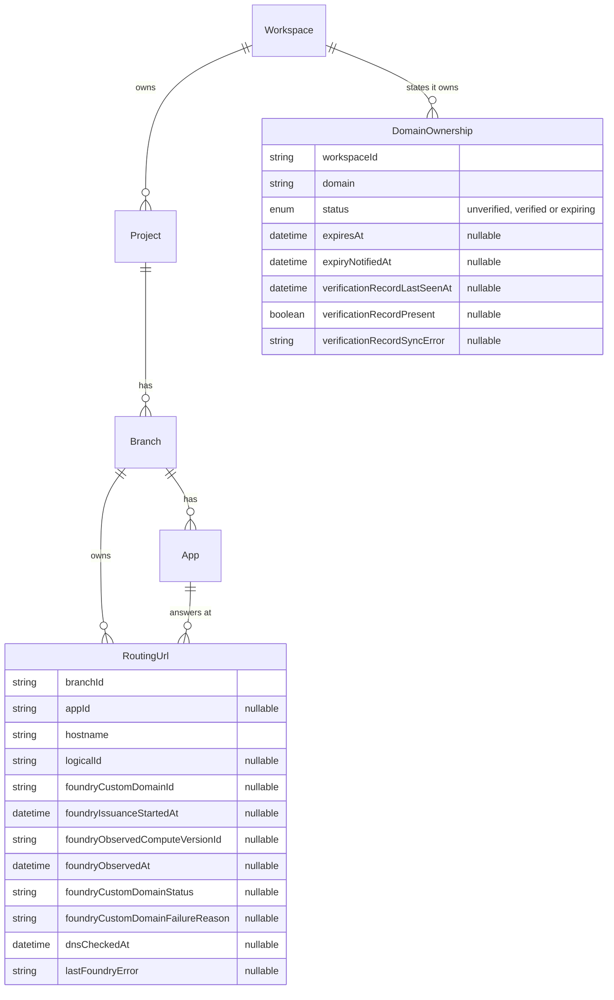

# Routing URLs and domain ownership

This is an older copy. The canonical, current version lives in prisma/pdp-control-plane at `docs/compute/RoutingUrls.md`.

The design for custom hostnames on Compute: the two records the control plane owns, the rules they follow, how the control plane keeps Foundry consistent with them, and what the Console shows. The decision and its alternatives are in [ADR 015](https://github.com/prisma/pdp-control-plane/blob/main/docs/architecture/adrs/ADR-015-routing-urls-and-domain-ownership.md). How each operation and lifecycle event moves the records is in [RoutingUrlLifecycle.md](platform-routing-url-lifecycle.md). The project that builds it is `projects/routing-urls/`.

## Words used

- A **service** is a Compute service. In code and in the database its model is `App`, and columns that point at one are `appId`.
- A **deployment** is one deployed build of a service. Its code runs in Foundry as a **compute version**, whose id the Deployment row stores as `foundryVersionId`. The **live deployment** is the one receiving traffic. Promote, rollback, stop and delete change which deployment is live.
- **Foundry** is the Metal team's service that runs compute versions and owns two registries: the **endpoint** registry, which maps a `prisma.build` prefix to a compute version, and the **custom domain** registry, which maps a customer hostname to a compute version and holds its certificate status. A custom domain has an id (`dom_…`) and a status: `provisioning`, `active` or `failed` with a failure reason. Foundry refuses to create a custom domain until the hostname's DNS points at the regional switchboard, and it issues the certificate asynchronously after creation.
- **Conduit** is the regional edge, reached at `switchboard.<region>.prisma.build`. It terminates TLS and routes each request by its Host header, reading Foundry's two registries.

## The records

### RoutingUrl

A row is one custom hostname and the service it reaches.

| Column | What it holds |
| --- | --- |
| `branchId` | the Branch that owns the row. The row lives as long as the Branch does, also while `appId` is null |
| `appId` | the service the hostname reaches. Null after the service is deleted; the row stays |
| `hostname` | the hostname in canonical form: lowercase, no trailing dot, international labels in punycode |
| `logicalId` | an identifier a deploy tool writes so it can find the row again. Composer writes the node's address. Null for rows made in the Console or by the backfill |
| `foundryCustomDomainId` | the id of the Foundry custom domain for this hostname, once the control plane has created it. Null before that, and null again when the deployment it was bound to is deleted, because Foundry deletes the custom domain with the compute version |
| `foundryIssuanceStartedAt` | when the current certificate issuance began: the custom domain's creation, the most recent retry, or, for a row that is still `provisioning` and has no start time because it was backfilled or its custom domain was adopted from the live compute version's list, the first time Foundry reported it; the clock for how long issuance may take |
| `foundryObservedComputeVersionId` | the compute version the custom domain was bound to when Foundry was last read |
| `foundryObservedAt` | when Foundry was last read for this row. Written only from Foundry's replies. Emptied after a call whose outcome was unknown, when the control plane no longer knows what Foundry holds, and cleared, with the other status columns, together with `foundryCustomDomainId` whenever the custom domain is gone: on a 404, when the operation deletes it, and when `deleteDeployment` deletes the compute version it was bound to |
| `foundryCustomDomainStatus`, `foundryCustomDomainFailureReason` | Foundry's status and failure reason for the custom domain, as last read |
| `dnsCheckedAt` | when the hostname's DNS was last seen pointing at the regional switchboard; null if it was not |
| `lastFoundryError` | the error from the last Foundry call that failed, cleared by the next success |

How the hostname was chosen is part of the operation that created the row, not a column. The status columns, `foundryObservedComputeVersionId`, `foundryCustomDomainStatus`, `foundryCustomDomainFailureReason` and `foundryObservedAt`, hold what Foundry last reported and when; the rest of the row is the spec. They are what let the database say, without calling Foundry, whether the row is in sync; a change to the App's live deployment leaves them as they are and changes only what the row is compared against. It is in sync in two cases: no custom domain should exist and the row holds no custom domain id; or a custom domain should exist, the row holds its id, `foundryObservedAt` is not empty, the compute version Foundry last reported is the live deployment's, and the certificate is active. In every other case it is out of sync. A service may have any number of rows. Rows are soft-deleted like the other models.

### DomainOwnership

A row is a workspace's intent to own one domain, its status, and the result of the last DNS lookup of its verification record. The row is written when the workspace asks for it, before any lookup, with status `unverified`.

| Column | What it holds |
| --- | --- |
| `workspaceId` | the workspace the domain ownership belongs to |
| `domain` | an exact hostname (`shop.com`) or an exact wildcard with one leading `*.` label (`*.preview.shop.com`), canonical as above |
| `status` | `unverified`, `verified` or `expiring`. Set by `syncDomainOwnership` from each lookup of the record name, and by the backfill. See "The domain ownership's status" |
| `expiresAt` | when the domain ownership expires, 30 days after it became `expiring`. Set when the status becomes `expiring`, and cleared when it leaves. A CHECK constraint keeps it set exactly while the status is `expiring` |
| `expiryNotifiedAt` | when the expiry email was queued. Set once each time the domain ownership becomes `expiring`, from slice 4 of the routing-urls plan; cleared when the status enters or leaves `expiring` |
| `verificationRecordLastSeenAt` | when DNS last answered the lookup. Null before the first lookup, and after a lookup that got no answer while the status was not `verified` |
| `verificationRecordPresent` | whether that answer carried the workspace's value. Null exactly when `verificationRecordLastSeenAt` is null |
| `verificationRecordSyncError` | the error from the last sync: `DNS unavailable` when the lookup got no answer. Null when that sync succeeded |

A domain ownership is **verified** exactly when its status is `verified`. One live row per workspace and domain.

### The domain ownership's status

`syncDomainOwnership` looks up a record name once and sets the status of every live domain ownership at that record name, in every workspace. The new status depends only on the status before, what the lookup found, and the time:

| Before | The lookup finds | After |
| --- | --- | --- |
| any | its own workspace's value | `verified` |
| any | another workspace's value, and not its own | `unverified` |
| `verified` | no workspace's value | `expiring`, with `expiresAt` 30 days later |
| `expiring`, before `expiresAt` | no workspace's value | unchanged |
| `expiring`, at or after `expiresAt` | no workspace's value | `unverified` |
| `unverified` | no workspace's value | `unverified` |
| any | DNS gave no answer | unchanged |

Leaving `expiring` clears `expiresAt` and `expiryNotifiedAt`. Later lookups that still find nothing do not move `expiresAt`. A lookup that gets no answer changes no status: an unreachable DNS server is not evidence that the record is gone.

**Expiry.** Every domain ownership follows the same rule; the backfill's get no special treatment after they are created. `expiring` means the record was not found, and the hostnames the domain ownership keeps serving keep serving until `expiresAt`. It never lets a new hostname start serving, and it does not count as verified. To add a hostname under it, the user publishes the TXT record and presses Check; the lookup finds the value and the domain ownership becomes `verified`. If no lookup finds the record before `expiresAt`, the first lookup after it makes the domain ownership `unverified`, and the hostnames nothing else keeps serving stop. When a domain ownership becomes `expiring`, the workspace gets an email asking it to publish the record. Verified domain ownerships are not rechecked on a schedule, so the 30 days start at the first lookup after the record disappears. From slice 4, a daily cron job makes sure a lookup happens after each `expiresAt` passes.

**Another workspace's value makes a domain ownership `unverified` at once.** That workspace now controls the domain's DNS, for example because the domain was sold. Waiting for `expiresAt` would keep the hostname registered in Foundry to the old owner and block the new owner for 30 days.

## The six conditions

A RoutingUrl serves traffic only when all six of these are true. Each can become true or false on its own and in any order, which is why the row has no single status.

| Condition | Meaning | Where it comes from |
| --- | --- | --- |
| ownership verified | a covering DomainOwnership in the workspace has status `verified`; or the hostname is already serving and a covering one has status `expiring`, in which case the condition reports `expiresAt` and names the TXT record to publish by that date. A DomainOwnership covers the hostname when it equals it, or is a wildcard whose `*` stands for the hostname's first name part; while ownership is not met, the condition carries the TXT record to publish | the DomainOwnership table, read when the row is served |
| service present | `appId` points at a service that exists | the App table |
| live deployment | that service has a live deployment | the Deployment table |
| DNS points at the switchboard | the hostname's first CNAME target is the regional switchboard, or its address records resolve to it (Cloudflare-flattened apex domains) | looked up; `dnsCheckedAt` |
| custom domain bound | a Foundry custom domain exists for the hostname, this row holds its id, and Foundry last reported it bound to the live deployment's compute version, with `foundryObservedAt` not empty | `foundryCustomDomainId`, `foundryObservedComputeVersionId`, `foundryObservedAt` |
| certificate active | Foundry reports the custom domain's status as `active` | `foundryCustomDomainStatus` |

The row reports every condition and the first unmet one as the next thing the user has to do, with the exact DNS record to publish. When the unmet condition is that another row holds the hostname's custom domain, the report names that row's workspace, project and service to a caller who can access that workspace, and says "held by another workspace" to one who cannot.

## The rules

**Nothing is created on its own.** A deploy tool creates a RoutingUrl for each hostname its code declares. A Console user creates one on the service's page. The platform creates none.

**A row exists before its DNS does.** Creating one stores the record and calls nothing in Foundry. The conditions say what is missing.

**One row serves a hostname.** Any number of rows may name a hostname; creating one never fails on that account. At most one row on the whole platform holds a Foundry custom domain for a hostname, enforced by a unique index on `hostname` over live rows whose `foundryCustomDomainId` is set. Creating the custom domain takes a database advisory lock keyed by the hostname, so two rows in different regions cannot both create one at once. A row that cannot create one reports the hostname as in use, as above. The hostname passes to another row only when the holder's custom domain is deleted. This is about traffic, not ownership: it stops two services receiving the same requests.

**Ownership is a DomainOwnership, and DNS proves it.** The proof is the check the platform already does: `_prisma-verification.<domain>` (for a wildcard, at its base domain) must carry `prisma-verification=<hash of the workspace id>`. Creating a domain ownership, from the Console's Domains page or the create route, stores the row with status `unverified`, calls `syncDomainOwnership`, and returns the row with the record to publish. The create route accepts a wildcard, and it is the only way a wildcard domain ownership is created. A RoutingUrl whose hostname no verified domain ownership covers carries the TXT record among its conditions, as the thing to publish. `createRoutingUrl` and `updateRoutingUrl` take `createDomainOwnership`, a boolean that defaults to `true`: when it is `true` and no covering domain ownership is `verified`, they create an unverified domain ownership for the exact hostname if none exists. Composer leaves it at `true` (design note 7, settled 2026-11-06); the platform documents still say Composer passes `false`. Because one lookup answers for every row at a record name, a sync of any one of them sets the status of all of them, in every workspace. When another workspace publishes its value and its domain ownership is synced, this workspace's domain ownership becomes `unverified`; it is not deleted, and every RoutingUrl it alone kept serving stops serving and loses its custom domain. Two workspaces can hold verified domain ownerships for one domain; which service a hostname reaches is decided by the custom-domain rule, not by ownership.

**A domain ownership belongs to the workspace** because the TXT value is a hash of the workspace id and nothing smaller. A domain ownership for `shop.com` says nothing about `www.shop.com`; a wildcard's `*` stands for exactly one name part: `pr-42.preview.shop.com` but not `a.b.preview.shop.com`. This is the convention of Cloudflare, AWS Certificate Manager, Azure and ACME. Either order works: create the domain ownership in the Console first, or deploy first and follow the row's setup link.

**The RoutingUrl repository keeps Foundry consistent with the row**, the way [the proposal for keeping the data plane consistent with the control plane](https://github.com/prisma/pdp-control-plane/blob/main/docs/data-plane-consistency/README.md) says every system below the control plane is kept consistent: what Foundry should hold is computed from the database alone, compared with what it was last seen to hold, and the difference is acted on; each reply from Foundry is recorded in the status columns, and Foundry is read only when they are empty or a certificate is still being issued. The RoutingUrl is the source of truth. Whenever a row is written, or a service's live deployment changes, or a service or Branch is deleted, the repository computes the row's conditions and makes the Foundry call the row needs, if any, and records a failure on the row instead of dropping it. When Foundry reports the custom domain `failed` for a DNS reason and the control plane's own DNS check now passes, the repository calls Foundry's retry route; any other failure is left for the user's retry in the Console, as today. When a Foundry call fails, or leaves the custom domain in the transient `provisioning` state while its certificate is issued, the repository enqueues a delayed message for the row on a Worker queue; the consumer runs the same repository operation again, with backoff and a bounded number of attempts after a failure, and at a fixed interval for as long as Foundry's issuance timeout while a certificate is issuing, so a failed reassign at promote repairs itself and a certificate completes without the user pressing anything twice. When a row's custom domain is deleted, the operation also runs for every other live row naming the same hostname, so a waiting row in another workspace gets the hostname without anyone acting. The two facts nobody tells the control plane about, the hostname's DNS and the custom domain's certificate, are looked up when the row is written and when the user presses the check button in the Console, which runs the same operation. A Worker cron that runs the operation for every row not yet serving, so the button becomes unnecessary, is a stretch goal at the end of the project. Details in [RoutingUrlLifecycle.md](platform-routing-url-lifecycle.md).

**A change that leaves the routing table the same never touches a certificate.** When a row is deleted and another live row names the same hostname on the same service, the repository moves the custom domain id, its issuance start time, and its status columns to that row instead of deleting the custom domain and creating it again.

**A row survives its service.** Deleting the service sets `appId` to null and deletes the custom domain; the hostname, its DNS and its domain ownership stay, and the next deploy that declares the hostname points the row at the new service. Stopping a service's live deployment leaves the custom domain in place, bound to the stopped compute version, and the row reports "custom domain bound" as unmet until a deployment is live again. Deleting the live deployment deletes the custom domain with its compute version, so the repository clears `foundryCustomDomainId`, `foundryIssuanceStartedAt`, the status columns in that operation and creates the custom domain again when a deployment is live. A row is deleted when its Branch is deleted (also through project or workspace deletion) or when a user or deploy tool deletes it.

**A deploy finds its row by `logicalId`**, looked up by Branch. The platform never resolves anything by it. Changing a row's hostname or service updates the same row.

## Management API

| Route | Purpose |
| --- | --- |
| `POST /v1/services/{id}/urls`, `GET /v1/services/{id}/urls` | create and list a service's rows |
| `GET`, `PATCH`, `DELETE /v1/urls/{id}` | read with conditions; change hostname, service (same Branch) or `logicalId`; delete |
| `GET /v1/projects/{id}/branches/{id}/urls?logicalId=` | a Branch's rows, filtered for deploy tools |
| `GET /v1/workspaces/{id}/domain-ownerships/verification?domain=…` | the TXT record to publish for a domain; creates nothing. Every domain ownership also carries its record |
| `POST`, `GET /v1/workspaces/{id}/domain-ownerships`; `GET`, `DELETE /v1/domain-ownerships/{id}` | create (201 with the row and its status; 200 with the existing row when the workspace already has one), list, read, delete |
| `POST /v1/domain-ownerships/{id}/verify` | look the record up now and return the row: 200. When DNS gave no answer, the row is returned with its status unchanged |

Mutations go through interactors: create, update and delete a RoutingUrl; create, check and delete a DomainOwnership (`createDomainOwnership`, `checkDomainOwnership`, `deleteDomainOwnership`), where create and check call `syncDomainOwnership` and return the row. The domain ownership routes live under `/v1/workspaces/{workspaceId}/domain-ownerships` and `/v1/domain-ownerships/{id}`, because the resource is a workspace's ownership of a domain, not the domain. Every domain ownership route, including the id-addressed ones, requires the caller to have access to the domain ownership's workspace, as every RoutingUrl route requires access to the row's project; a caller without it is answered as if the domain ownership did not exist. A domain ownership's representation carries `domain`, the `verification` record, `status` (`unverified`, `verified` or `expiring`), `expiresAt` (nullable), `verificationRecordLastSeenAt`, `verificationRecordPresent` and `verificationRecordSyncError`. Reads are routes over the repositories. RoutingUrl responses carry the six conditions, the record to publish for each unmet condition that has one (the TXT record for ownership verified, the CNAME for DNS points at the switchboard; the others have none), and the Console setup link. The existing `/v1/services/{id}/domains` and `/v1/domains/{id}` routes become a view over RoutingUrls for one deprecation cycle. The Alchemy Prisma provider gains a `Prisma.RoutingUrl` resource over these routes, replacing `Prisma.CustomDomain` for Composer.

## Console

The service page's Domains section lists the service's RoutingUrl rows: hostname, conditions met, the next thing to do with the record to copy, and the holder of a contested hostname where the viewer may see it. Adding a domain creates a row; removing one is a double-confirmed dangerous action. The endpoint is shown where it is today.

Workspace settings gains a Domains page: the workspace's domain ownerships, each with its status and its TXT record. A verified one shows when DNS last confirmed it. An `expiring` one shows the date it expires, and says its hostnames stop serving then unless the record is published. Every row has a check button and delete. The plus button takes a domain or a wildcard, creates the domain ownership, and shows it. Hostnames whose ownership is not yet verified are shown on their services, with the record to publish, not here. The page ships behind a feature flag until the rest of the increment lands.

## Existing custom domains

Every Foundry custom domain becomes a RoutingUrl on the service owning its compute version, carrying the custom domain's id and region, with status `active` and no `logicalId`. Foundry lists custom domains per compute version, so the backfill walks the deployments. Where Foundry holds one hostname in two regions, neither gets a RoutingUrl, and both are reported for an operator.

Until 24 October 2026, custom domains were created without a TXT check, so the platform has no proof of ownership for them. Unless a domain ownership with status `verified` in the workspace already covers the hostname, the backfill gives the workspace an `expiring` domain ownership for the exact hostname, with `expiresAt` 30 days after the backfill; an existing exact-hostname one with status `unverified` becomes `expiring` the same way. The RoutingUrl stays active, because an `expiring` domain ownership keeps an active RoutingUrl serving. The backfill then queues a `syncDomainOwnership` of each, and sends no email itself. The first lookup decides:

- Record found: `verified`, and no email.
- No value found: it stays `expiring`, and the sync sends the expiry email.
- Another workspace's value found: `unverified`, the RoutingUrl stops, and the stopped-serving email is sent.

From then on the domain ownership follows the same rules as every other one. Slice 4 of the routing-urls plan, with both emails and the daily cron job, merges before the backfill runs.

Branch cleanup's rule that retains a Branch with a custom domain reads RoutingUrl rows instead of Foundry; the rule is no longer needed and its removal is separate work.

## The next step: the prisma.build hostname as a RoutingUrl

Today every service is reachable at its endpoint whether or not anyone meant it to be. The next step of this design makes the endpoint a RoutingUrl, created like any other through an operation that takes the hostname from the service, so that a service nothing should reach from outside has no public hostname. Such a row stores no Foundry id, because Foundry keys endpoints by their prefix, which the hostname contains. The scenarios that step has to satisfy are recorded in [step-two-migration-scenarios.md](step-two-migration-scenarios.md). A deploy tool whose older versions never knew about RoutingUrls takes ownership of the rows that exist on its own side: Composer's Alchemy resource finds a live row on the same service with the same hostname and no `logicalId`, writes its `logicalId` on it through the update route, and records it. The platform writes no `logicalId` and derives none. Private routing in Foundry is outside this design.
