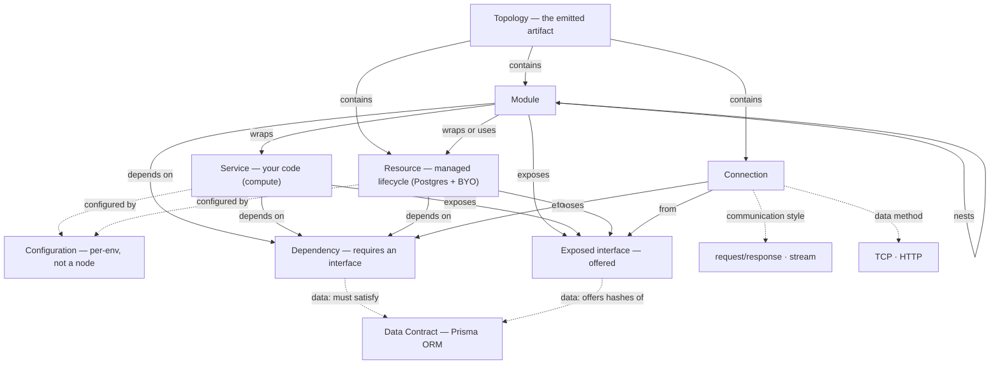

# Domain map

The conceptual map of Prisma Composer's **authoring plane** — the
things a developer models and how they relate. For how these lower to Alchemy
and Prisma Cloud, see `layering.md`; for definitions, see `glossary.md`.

(Prisma Composer's *own* internal architecture — its
control/execution-plane contexts, emitter, runtime — is a separate concern for
the architecture phase, not this map.)

## How to read it

- **A Module wraps Services and Resources** and is reachable from the outside *only*
  through its dependencies and exposed interfaces. That boundary is what makes the topology
  truthful — every cross-Module dependency is an edge.
- **Nesting isn't a special case.** A Module behaves like a Service — stateless, with
  typed dependencies and exposed interfaces — so a nested Module is wired exactly as a
  Service is. A wrapped node's dependencies and exposed interfaces connect to the parent
  Module's boundary or to a sibling inside the Module; it reaches outside only through the
  parent's boundary.
- **Every node — Module, Service, or Resource — depends on interfaces and exposes
  interfaces.** A connection wires a dependency to an exposed interface, and the rule is
  uniform at every level: a dependency is satisfied by a sibling's exposed interface, a
  Resource's, or one the enclosing Module forwards in from its own boundary. A node may
  expose nothing, as a public URL does.
- **Leaf vs composite; the outermost Module.** A Service is a *leaf* — the
  framework sees only its boundary. A Module is a *composite* — it owns the wiring
  among what it contains. The whole module is the **outermost Module**, owning
  the top-level Module-to-Module wiring and any shared Resources. *Who owns the
  wiring owns the migration:* a shared database is owned and migrated by the
  outermost Module; a private one by its Module.
- **Every node carries a managed lifecycle** — Services (your code) and Resources
  (managed dependencies). That's what lets the whole topology be recreated in a new
  environment and reproduced in the local emulator.
- **Configuration is not a node.** Keys, URLs, and secrets parameterise Services
  and Resources and are injected per environment. An external service you don't
  provision lives here — surfaced as a Service's **egress** (an outbound dependency
  plus its config), never an edge to a node. Provision it (a Resource) or wrap it
  in a Service to bring it into the graph.
- **Two families of connection:**
  - **communication** (Module ↔ Module, or public **ingress**) with a **style**:
    `request/response` or `stream`. The style is a property of the connection; no
    Resource sits "in" it.
  - **data** (Module → Postgres Resource) with a **method** (`TCP` / `HTTP`) and a
    **Data Contract**. The Postgres exposes a data interface (the contract hashes
    it satisfies); the Module's data dependency requires a contract; the wire is valid
    iff the offered hashes satisfy it.
- **The Topology is the artifact.** The framework infers the graph from TypeScript and
  emits it.

## Dependency direction

The clean-architecture intent carries over: low-level Resources don't depend on
Modules; Modules depend on Resources and on each other's exposed interfaces. Composition (the
wiring) is explicit and lives in the topology, not in ambient/global state.

## Open questions

- **Stream attributes** — since a stream is a connection *style* and never a
  Resource node, attributes like retention and consumer groups would live on the
  connection. Where exactly is TBD.
