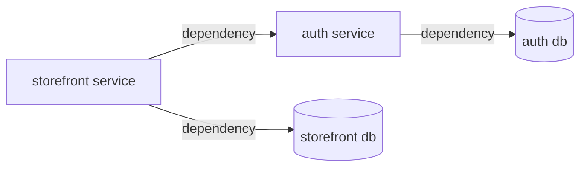
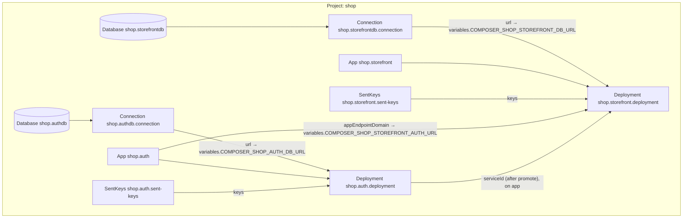

# Alchemy ↔ PDP — the resources we bind and how they map

The Alchemy resource types Composer lowers to over the
[PDP data model](pdp-data-model.md), the mapping in both directions, and the
lowering graphs — including the correction that makes deploy ordering a property
of the dependency graph rather than luck.

The postgres family (`Project`, `Database`, `Connection`), the compute
family (`App`, `Deployment`, `EnvironmentVariable`) and the bucket family
(`Bucket`, `BucketAccessKey`) are **upstream alchemy's** (`@alchemy.run/prisma`), not
ours: Composer registers their providers and binds their props. What
`@internal/lowering` still owns is the artifact packager, `ServiceKey`, and the
hosted state store. A hosted deploy declares no `EnvironmentVariable`: a
service's `COMPOSER_` keys go in its Deployment's `variables`
([ADR-0069](../90-decisions/ADR-0069-a-services-composer-keys-travel-with-its-deployment-as-service-variables.md)).

## Placement: one Project per application, one Branch per environment

A PDP Project is a **shared config namespace** (every App on a branch snapshots
the same variable set into its versions) and a **shared lifecycle** (deletion
cascades). Prisma Composer's placement rule: **one Project per
Prisma Composer application** — all of an application's services are
Apps in that one Project, with the Module-provisioned Databases beside them.
Consequences, stated plainly:

- Config keys are namespaced per service by the pack's mapping (e.g.
  `AUTH_DB_URL`, `STOREFRONT_AUTH_URL`) — collisions are a naming concern the
  pack owns, not a reason to split projects.
- The Project is thereby also the **secret-visibility boundary**: every service on
  a Branch receives every variable of the group that Branch receives. A
  service's own `COMPOSER_` keys are service variables, stored on that service
  only. One application = one trust domain; anything that must not be visible
  across services belongs in a different project (a different application).

Every deploy environment — production, staging, a per-PR preview — is a
**Branch** of that one Project
([ADR-0023](../90-decisions/ADR-0023-a-prisma-app-is-one-project-a-stage-is-a-branch.md)).
The environment `production` (the default of `--environment`) is the
Project's default Branch, found by `isDefault`: resources carry no `branchId`
and no Branch is created for it — the CLI only *reads* the default Branch's
id, which becomes the Alchemy stage (the deploy-state scope, TML-3157). Any
other environment is the Branch whose `gitName` is the environment's name;
every resource the target provisions for it carries the Branch's id. A name
other than `production` that resolves to the default Branch (such as `main`)
is refused, since it would be production under a second name.
Resolving and creating the Branch — like the Project — happens **before**
Alchemy runs
([ADR-0024](../90-decisions/ADR-0024-a-stage-is-a-deploy-time-environment-resolved-to-project-and-branch.md));
Alchemy only diffs and provisions the resources *inside* a (Project, Branch),
never the container itself (see
[§ Environments and container resolution](#environments-and-container-resolution)).

## `DATABASE_URL` is forbidden — and left to the platform

The platform writes `DATABASE_URL` and `DATABASE_URL_POOLED` pointing at a project's default database, and marks them system-managed. It does so only when a project is created with a database, or when a database is created as the project's default. That is a convenience for hand-provisioned single services, and exactly the kind of implicit ambient config the framework exists to eliminate. The framework never reads either variable and never depends on it.

Framework-provisioned Projects are created with `createDatabase: false`, and the framework never creates a project default database, so on a Composer Project the platform writes neither variable. The framework writes no row of its own under either name, and nothing about them enters deploy state. The authoring-side ban remains: `variable()` and `variable.secret()` reject both names (`variable-name.ts`), so no platform variable the app declares can carry one. Every database URL a service actually consumes is an explicit, per-service variable the pack's `serialize` writes under its own named key, inside the `COMPOSER_` namespace.

A service that reads `process.env.DATABASE_URL` behind the framework's back sees whatever is on the platform under that name: nothing on a Composer Project, the platform's own value on a Project created outside Composer with a default database, or a value the user set. Older framework versions wrote the placeholder `"-"` under both names; those rows stay on existing Projects until the user deletes them ([deploying.md](../../guides/deploying.md) covers them).

## The resource inventory

Each row is a resource type the lowering binds. The `Prisma.*` families are
upstream `@alchemy.run/prisma` classes (ADR-0048) — Composer registers them in its
provider collection and defines resources only where no Management API exists
behind them.

| Resource (upstream `@alchemy.run/prisma`) | PDP entity it manages | Props (in) | Outputs (out) | Notes |
| --- | --- | --- | --- | --- |
| `Prisma.Project` | Project | name | projectId | **one per Prisma Composer application**; resolved by the CLI before Alchemy runs, so no lowering yields one |
| `Prisma.Database` | Database | project, name?, region, branchId?, logicalId? | databaseId, connection strings | one per Module-provisioned postgres resource; never the project default; a branch-attached database is created with `branchId` and no display name (upstream refuses the combination — see [deploying.md](../../guides/deploying.md)) |
| `Prisma.Connection` | database connection info | database, name | connectionId, directConnectionString | Composer binds the DIRECT string explicitly; upstream's `databaseUrl` is pooled-first |
| `Prisma.App` | App | project, displayName, regionId, branchId?, logicalId? | appId, appEndpointDomain | `branchId` targets the Branch of an environment other than `production`; omitted, upstream attaches the App to the project's default (production) Branch. `appEndpointDomain` is available at provision — that is what a service's own origin and its published `url` are read from |
| `Prisma.EnvironmentVariable` | ConfigVariable | project, class, key, value (Redacted), branchId? | environmentVariableId | declared by no hosted deploy. Its provider stays registered so Alchemy can delete the rows an older Composer wrote; Composer's layer around it drops a row the platform refuses to delete because its recorded identity differs, with a warning naming the key. Under `prisma dev`, `reserve` declares one per key a dev server reads |
| `Prisma.Deployment` | Deployment (ComputeVersion) + Promotion | app, artifactPath, artifactContentType, portMapping, variables, triggers, start, promote | deploymentId, appEndpointDomain | provider reconcile: create (with `variables`) → upload tar.gz → start → poll until running → promote; `appEndpointDomain` read **post-promote**; it is the same domain the App reports from its create. It is replaced, not updated, when its artifact fingerprint, its `variables` fingerprint or its `triggers` fingerprint moves, and when `variables` is declared on a deployment that recorded none. `variables` is a `pnpm` patch until the upstream release carries it |
| `SentKeys` (Composer's) | none | keys (this deploy's key names) | keys (every name ever given) | one per compute service; the deploy sends `null` for each recorded name it no longer sends. Holds names, never values |
| `Prisma.Bucket` | Bucket | project, name, branchId?, logicalId? | bucketId, name | one per bucket resource; `Prisma.BucketAccessKey` mints its read-write S3 credentials, which become the node's outputs |

`logicalId` is set on every deploy except branchless local dev; [§ Platform identity](#platform-identity-logicalid) says what it carries.

What we deliberately do **not** model yet, and where it will bite:
**Promotion** as a standalone resource (the Deployment provider
auto-promotes; rollback is unexpressed), and non-default **Databases** with
contracts. **Branch** is now resolved and threaded (see
[§ Environments and container resolution](#environments-and-container-resolution)) — but
only as a container id carried in providers' `branchId` props; it is never an
Alchemy resource itself, since its lifecycle lives outside Alchemy
(ADR-0024).

### Deleting an App gives up after about four seconds of conflicts

Upstream's `destroyApp` (`alchemy/src/Prisma/ComputeLifecycle.ts`) retries the
platform's 409 ("did not reach a delete-safe state") five times, sleeping
250 ms, 500 ms, 1 s and 2 s between attempts: about 3.75 seconds of waiting in
all. It does not wait for the App's deployments to drain first; it deletes the
App and relies on the platform's cascade. Composer's own provider, before the
upstream adoption, retried for up to 5 minutes.

Alchemy does delete a tracked `Prisma.Deployment` before the App that owns it,
because the resource graph orders them. A deployment still winding down can
still make the App delete 409 past that budget. The case to watch is
destroying an environment that served traffic seconds earlier. The upstream ask is in
[`.drive/deferred.md`](../../../.drive/deferred.md).

## Platform identity: `logicalId`

A node's address is the path of provision IDs starting at the root, and the root's address is the deployed app name (the root module's name, or `--name`): `shop`, `shop.catalog`, `shop.auth.api`. A node that has a platform row has exactly one row that represents it, and that row's `logicalId` is the node's address, byte for byte ([ADR-0057](../90-decisions/ADR-0057-a-nodes-address-is-its-full-path-from-the-app-name.md)). The application topology submitted on each deploy uses the same string for the node, and for its parent, so the platform can match the two.

| Node | Row that carries the `logicalId` | Written by |
| --- | --- | --- |
| the root | Project | container resolution, before Alchemy runs: `POST /v1/projects` with `logicalId`, and later deploys find the Project by it |
| compute service | App (the platform's Service table) | `Prisma.App(address, { …, logicalId: address })` |
| postgres resource | Database | `Prisma.Database(address, { …, logicalId: address })` |
| bucket | Bucket | `Prisma.Bucket(address, { …, logicalId: address })` |
| module | none | — |

Rules:

- The value is the address. Composer passes it explicitly, even where it equals the Alchemy resource ID, because upstream's Prisma resources default `logicalId` to their own fully qualified resource ID.
- For App, Database and Bucket, the resource that creates the row writes its `logicalId`, as a prop. No separate resource or later API call writes it.
- On the app's own Project and Branch, the row holding a node's `logicalId` is that node's row. The descriptors declare App, Database and Bucket resources with `asOwnRow` (Alchemy's `adopt(true)`), so a deploy resuming an interrupted create uses the row instead of failing with `OwnedBySomeoneElse`. On resume, Connections need nothing: their generated name already proves which create made them. Deployments and bucket access keys are never reported as someone else's, so an interrupted create of one is simply made again, and the first attempt can be left behind.
- Other platform rows a node lowers to carry no `logicalId`: `Prisma.Connection`, `Prisma.Deployment`, `Prisma.BucketAccessKey`. Composer's local resources (`ServiceKey`, `PgWarm`, `OrmMigration`, `GeneratedParam`, `SentKeys`, `S3Credentials`) create no platform row.
- Branchless local dev creates no platform rows and writes none.

### Resource IDs

Every Alchemy resource ID is built from the address. A node's main resource uses the address itself; every other piece adds `.` and a role. A module has no resources and a service or resource has no children, so `<address>.<role>` is never another node's address. Every resource also declares the ID the previous format gave it, with `renamedFrom` from `alchemy/Rename`, so an existing environment's first deploy with this format moves each state entry and updates the resource in place instead of recreating it. On an environment that never had the old ID, the declaration does nothing.

For the app `shop`:

| Node kind | Resource | ID | Renamed from |
| --- | --- | --- | --- |
| compute service `shop.web` | `Prisma.App` | `shop.web` | `web-svc` |
| | `Prisma.Deployment` | `shop.web.deployment` | `web-deploy` |
| | `SentKeys` | `shop.web.sent-keys` | (new) |
| | `Prisma.EnvironmentVariable` under `prisma dev`, one per key a dev server reads | `shop.web.env.<KEY>` | (none) |
| | `GeneratedParam`, one per generated input leaf | `shop.web.generated.<leaf path>` | `<old input KEY>:<leaf path>-generated` |
| | `ServiceKey` for an RPC input (per calling service and input) | `shop.web.servicekey.<input>` | `servicekey-web.<input>` |
| | `ServiceKey` for a streams provider (per providing service) | `<provider address>.streamkey` | `streamskey-<old provider address>` |
| postgres resource `shop.catalog` | `Prisma.Database` | `shop.catalog` | `catalog-db` |
| | `Prisma.Connection` | `shop.catalog.connection` | `catalog-conn` |
| | `PgWarm` | `shop.catalog.warmup` | `catalog-warm` |
| | `OrmMigration` (ORM postgres only) | `shop.catalog.migration` | `catalog-migrate` |
| bucket `shop.uploads` | `Prisma.Bucket` | `shop.uploads` | `uploads-bucket` |
| | `Prisma.BucketAccessKey` | `shop.uploads.accesskey` | `uploads-key` |
| s3 credentials `shop.creds` | `S3Credentials` | `shop.creds` | `creds-creds` |

Every role is a noun naming the piece: `deployment`, `sent-keys`, `env`, `generated`, `servicekey`, `streamkey`, `connection`, `warmup`, `migration`, `accesskey`. The old ID is computed in `legacy-resource-ids.ts` from `addressBelowApp(address, app)`, which removes the known `<app>.` prefix, by the rule the previous release used. `<old input KEY>` is the input document key the previous release used, built from that shorter address. Variable rows an older release wrote stay in deploy state under the ID they were stored with, and Alchemy deletes them as resources no longer declared.

**Platform names.** Every platform name Composer writes is the node's address (`shop.catalog`, `shop.auth.api`): the App `displayName`, the branchless Database `name`, and the Connection, Bucket and BucketAccessKey `name`. They are labels, never identity. Upstream adds `-` and a 12-character token to every Connection name, so a Connection's platform name is the address plus that suffix. `validatePlatformName` checks the address against each kind's limit (Connection 52, so the address fits beside the suffix in the platform's 65; Bucket 100; App 256; an access key has none) and fails naming the address; it never shortens a name. A hosted Database takes no name from Composer, because upstream refuses a name together with branch attachment; upstream derives its physical name from the resource ID and updates it in place.

On the upgrade deploy every one of these names changes from the short address to the full one. Upstream `@alchemy.run/prisma` replaces, rather than updates:

- a Connection when its `name` or database changes, which mints new credentials;
- a BucketAccessKey when its `name`, `role` or bucket changes, which mints new credentials;
- an App, Database or Bucket only when its project (or, for a Database, its region, source or default flag) changes;
- a Deployment when its artifact, `variables` or `triggers` fingerprint changes.

So the upgrade updates every App, Database and Bucket in place, along with every `logicalId` and a hosted Database's derived name; a Bucket's display name is not its S3 bucket name, so its objects stay. It recreates each of Composer's Connections and bucket access keys with new credentials, and Composer's services receive them in the same deploy. Each replace is create-first and then deletes only the old Connection or key, by the id Composer stored, after checking its database or bucket and name still match. The database, the bucket's objects and any Connection or key made by hand are untouched. Every `COMPOSER_` key changes name, so every service's `variables` changes and its Deployment is replaced.

Status:

- The Project carries its `logicalId` when Composer created it. Projects created before that are found by display name and have none.
- App, Database and Bucket rows carry the address as `logicalId` in every environment, through the prop upstream alchemy added in [alchemy-run/alchemy#1849](https://github.com/alchemy-run/alchemy/pull/1849) (first in `2.0.0-beta.83`). Rows created before that, or with the shorter address, gain the new value on their next deploy, as an in-place update. The `deploy-verify-destroy` CI action checks after each real deploy that every service, database and bucket node matches exactly one row on the environment's Branch (`scripts/e2e-verify-identity.ts`).
- With `prisma deploy --name`, the deployed name is the root's address everywhere: the Project's `logicalId`, the topology's root node, and the first segment of every other address.

## Environments and container resolution

`@internal/lowering` also hosts the **container-resolution client** (`resolveContainer` / `deleteBranch`) the deploy CLI runs *before* the stack is lowered, not through an Alchemy resource: `resolveContainer` finds-or-creates the app's Project (by `logicalId`, the app name; when no Project has it, by display name, oldest first) and the environment's Branch (the default Branch for `production`; otherwise found by `gitName`, created if absent); `ensure: false` makes it find-only, for `destroy`. It reuses the same Management API client and the same adopt-oldest / tolerate-a-racing-409 idiom the state store's own bootstrap uses ([ADR-0034](../90-decisions/ADR-0034-deploy-state-lives-in-the-stage-branch.md)) — the two resolve different things (deploy containers vs. the environment's state database) through the same client and idiom. Once `destroy` has removed an environment's members, the CLI removes the environment's state database (ownership-verified) and `deleteBranch` then soft-deletes its Branch, except for `production`, whose default Branch is never deleted.

Deploy state keeps its existing shape — keyed per Alchemy `--stage`
(ADR-0034) — unchanged by this: in Alchemy's terms, **the Project is the
stack and the environment's Branch is the stage**
([ADR-0023](../90-decisions/ADR-0023-a-prisma-app-is-one-project-a-stage-is-a-branch.md)),
so an environment's effective identity is the pair (Project, Branch), and the
environment's state database lives inside that same Branch. The store's internal
logic is untouched.

## The mapping, both directions

- **Ours → PDP**: each resource's provider (`reconcile`/`delete`) calls the
  Management API; the table above is that mapping. One resource maps to one PDP
  entity except `Deployment`, which spans version-create + upload + start +
  promote (and therefore owns the env-snapshot moment, and carries the
  service's `variables`).
- **PDP → ours**: `foundryVersionId`, `Promotion`, and Foundry's version record have no resource of ours; they are internal to the `Deployment` provider's behavior or unmodeled. **Branch** likewise has no Alchemy resource — it is resolved and its lifecycle managed by the CLI's container-resolution client, outside the Alchemy graph entirely (see [§ Environments and container resolution](#environments-and-container-resolution)). `serviceEndpointDomain` surfaces as `App.appEndpointDomain` and `Deployment.appEndpointDomain`; both are the same domain.

## The lowering graphs

Lowering turns Prisma Composer's semantic graph into an Alchemy
resource graph. Arrows read "depends on / consumes a value from"; Alchemy
executes in dependency order and **runs unordered resources concurrently —
declaration order is never consulted** — so every ordering the framework's
semantics require must exist as an edge.

**Prisma Composer's graph** (what the user means):

**The Alchemy graph it lowers to** (one Project — the application):

How the pieces map:

- **The application** lowers to one `Project`, resolved by the CLI before
  Alchemy runs. It provisions no variables of its own.
- **Each service** lowers to an `App → Deployment` chain, a `SentKeys` record,
  plus its own `Database → Connection`, whose url is one of that service's
  **explicitly named** keys in the Deployment's `variables` — the same
  `serialize` path as any other config value.
- **The connection** lowers to two edges: the producer's App's endpoint domain becomes a named key in the consumer's Deployment's `variables`, and the producer's outputs ride the consumer's `app` prop. The domain comes from the App, not the Deployment: the Deployment is promoted on every deploy, so its domain is unknown while planning, and a consumer's deployment, whose `variables` hold the value, would be replaced on every deploy. Because the App's domain is known, an unchanged consumer keeps its deployment when its producer is redeployed.
- Every value a Deployment boots with is in its `variables`, so Alchemy schedules the Deployment after every resource those values come from.
- Every output of a consumer's producers is threaded into its Deployment's `app` too, so its deployment waits for its producers' promotion: a Compute producer's `serviceId` comes from its Deployment and resolves only after the promotion. The wait is on `app`, not in `triggers`, and upstream treats an unresolved `app` as unchanged, so an unchanged consumer is not replaced.
- The Deployment's `portMapping.http` rides the same seam: `serialize` resolves
  the service's `port` param from the typed Config and surfaces it in its
  outputs, and `deploy` routes the platform to it — so the routed port and the
  `PORT` the app binds trace to one value and cannot drift.

That ordering mirrors PDP's own dataflow — the deployment-create call
contains the service's variables, so they are genuinely an input to a
deployment (see the
[config lifecycle](pdp-data-model.md#the-config-lifecycle--what-is-resolved-when)).

**Why the producer edge rides `app`.** Upstream's `Prisma.Deployment` has no prop for "wait for these". Alchemy derives its dependency graph from the resource references a prop's *value* is built from, so the descriptor builds `app` as an Output over the app id and every output of the service's producers, resolving to the app id itself (`appAfter`): the graph gains the edges. The edge cannot ride `artifactPath` (or any of upstream's other replacement-block props): the diff reads that block as one unit and gives no opinion the moment any member is unresolved, which would skip the artifact comparison and silently drop a code change. [ADR-0048](../90-decisions/ADR-0048-prisma-cloud-resources-come-from-the-upstream-alchemy-provider.md) records the full argument, and `compute/__tests__/deployment-edge.test.ts` drives upstream's real diff.

**Change propagation is wired through `variables` and `triggers`.** The platform copies a deployment's environment at create, so a *value* change (a rotated URL) reaches a running service only through a new deployment. Upstream records a salted hash of the resolved `variables` and plans a replacement when it moves, when a value cannot be resolved at plan time because the producing resource is itself changing, and when `variables` is declared on a deployment that recorded no hash. Unchanged service → same hash → reuse; changed value or artifact → replace. Because upstream resolves the actual values, a value re-issued under a stable resource identity (a connection rotated in place, a re-minted service key) replaces too. Every key the service reads at boot is in `variables`, as its value or `null`, and `SentKeys` adds `null` for every key an earlier deploy sent and this one does not, so a removed key is deleted from the service ([ADR-0069](../90-decisions/ADR-0069-a-services-composer-keys-travel-with-its-deployment-as-service-variables.md)). The values are stored in deploy state in plain text: Alchemy writes every prop to state, and a `Redacted` value as its text; each is a value the deploy produced, never a platform variable's. A platform variable the service reads (operator-owned; Composer never holds its value) contributes a `<name>:updatedAt` member to `triggers` instead, read at preflight and handed to the lowering in the extension's preflight payload, so an out-of-band rotation still ships a new deployment. A service's input document is not in `variables` and has no trigger member: it travels in the service's artifact, in the `inputDocument` field of `compute.bootstrap.json` ([ADR-0065](../90-decisions/ADR-0065-a-compute-services-input-document-travels-in-its-artifact.md)), so a changed document changes the artifact's bytes and its content-addressed `artifactPath`, which replaces the deployment. A platform variable the document names is still a `<name>:updatedAt` member.

The compute descriptor constructs these edges (the `serialize` map threads into `deploy` through the service SPI, and the producers' outputs come from the lowering context); no app author ever hand-wires them.

## Related

- [`pdp-data-model.md`](pdp-data-model.md) — the platform model these resources manage.
- [`build-reporting.md`](build-reporting.md) — how a deploy reports itself and the resources it touched as a Build.
- [`../10-domains/core-model.md`](../10-domains/core-model.md) — the SPI that
  drives this lowering (three execution paths, phased service SPI).
- [`../10-domains/deploy-cli.md`](../10-domains/deploy-cli.md) § Environments
  and containers — the CLI pipeline step that drives the container resolution
  described here.
- [`../03-domain-model/glossary.md`](../03-domain-model/glossary.md) § compile
  target — the Alchemy substrate itself.
- [ADR-0023](../90-decisions/ADR-0023-a-prisma-app-is-one-project-a-stage-is-a-branch.md)
  / [ADR-0024](../90-decisions/ADR-0024-a-stage-is-a-deploy-time-environment-resolved-to-project-and-branch.md)
  — the decisions this section documents.
- [ADR-0057](../90-decisions/ADR-0057-a-nodes-address-is-its-full-path-from-the-app-name.md) — a node's address is its full path from the app name, its `logicalId` on the platform, and the base of its resource IDs.
