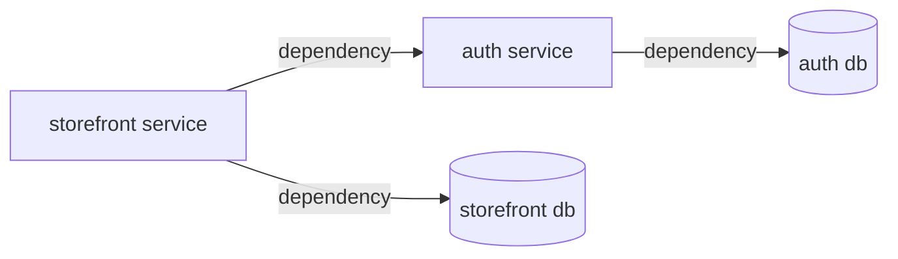
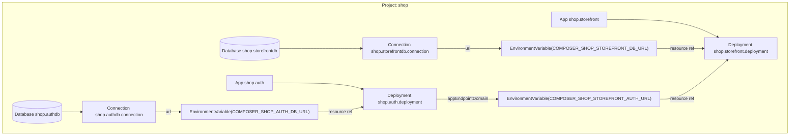

# Alchemy ↔ PDP — the resources we bind and how they map

The Alchemy resource types Composer lowers to over the
[PDP data model](pdp-data-model.md), the mapping in both directions, and the
lowering graphs — including the correction that makes deploy ordering a property
of the dependency graph rather than luck.

The postgres family (`Project`, `Database`, `Connection`), the compute
family (`App`, `Deployment`, `EnvironmentVariable`) and the bucket family
(`Bucket`, `BucketAccessKey`) are **upstream alchemy's** (`alchemy/Prisma`), not
ours: Composer registers their providers and binds their props. What
`@internal/lowering` still owns is the artifact packager, `ServiceKey`, and the
hosted state store.

## Placement: one Project per application, one Branch per environment

A PDP Project is a **shared config namespace** (every App on a branch snapshots
the same variable set into its versions) and a **shared lifecycle** (deletion
cascades). Prisma Composer's placement rule: **one Project per
Prisma Composer application** — all of an application's services are
Apps in that one Project, with the Module-provisioned Databases beside them.
Consequences, stated plainly:

- Config keys are namespaced per service by the pack's mapping (e.g.
  `AUTH_DB_URL`, `STOREFRONT_AUTH_URL`) — collisions are a naming concern the
  pack owns, not a reason to split projects.
- The Project is thereby also the **secret-visibility boundary**: every service's
  process env physically contains its co-located siblings' variables. One
  application = one trust domain; anything that must not be visible across
  services belongs in a different project (a different application).

Every deploy environment — production, staging, a per-PR preview — is a
**Branch** of that one Project
([ADR-0023](../90-decisions/ADR-0023-a-prisma-app-is-one-project-a-stage-is-a-branch.md)).
The environment `production` (the default of `--environment`) is the
Project's default Branch, found by `isDefault`: resources carry no `branchId`
and no Branch is created for it — the CLI only *reads* the default Branch's
id, which becomes the Alchemy stage (the deploy-state scope, TML-3157). Any
other environment is the Branch whose `gitName` is the environment's name;
every resource the target provisions for it carries the Branch's id. A name
other than `production` that resolves to the default Branch (such as `main`)
is refused, since it would be production under a second name.
Resolving and creating the Branch — like the Project — happens **before**
Alchemy runs
([ADR-0024](../90-decisions/ADR-0024-a-stage-is-a-deploy-time-environment-resolved-to-project-and-branch.md));
Alchemy only diffs and provisions the resources *inside* a (Project, Branch),
never the container itself (see
[§ Environments and container resolution](#environments-and-container-resolution)).

## `DATABASE_URL` is forbidden — and left to the platform

The platform writes `DATABASE_URL` / `DATABASE_URL_POOLED` templates pointing at
a project's default database — a convenience for hand-provisioned single
services, and precisely the kind of **implicit ambient config the framework
exists to eliminate**. The framework never reads it and never depends on it.
Framework-provisioned Projects are created with `createDatabase: false`, so no
default database exists on them — but that alone does not keep the variable
away: the platform self-heals a missing `DATABASE_URL` template on the first
Compute deploy, wiring it from any ready database on the Project (default
first, then oldest) — on a Composer Project, one of the app's own databases.

So the framework claims the keys first. `application.provision` writes
`DATABASE_URL` and `DATABASE_URL_POOLED` (production and preview class,
project-level) with the placeholder value `"-"` via create-only calls
(`lowering/src/database-url-claim.ts`). The platform's writes are also
create-only, so whoever writes first wins permanently: on a fresh Project the
claim lands first and the self-heal never fires; on a Project whose variables
the platform already seeded, the claim gets a 409 and no-ops. The rows are
plain platform variables, never Alchemy resources — nothing enters deploy
state and upstream's `EnvironmentVariable` never owns them. Alongside the
claim, the authoring-side ban holds: `param.ts` and `secret.ts` reject both
names, so no Composer-declared row can carry one. Every database URL a
service actually consumes is an explicit, per-service variable the pack's
`serialize` writes under its own named key, inside the `COMPOSER_` namespace.

A service that reads `process.env.DATABASE_URL` behind the framework's back
therefore reads the placeholder `"-"` and fails loudly — or, on a Project the
platform seeded before the framework ever deployed to it, the platform's own
template ([deploying.md](../../guides/deploying.md) covers the leftover rows
and manual cleanup).

## The resource inventory

Each row is a resource type the lowering binds. The `Prisma.*` families are
upstream `alchemy/Prisma` classes (ADR-0048) — Composer registers them in its
provider collection and defines resources only where no Management API exists
behind them.

| Resource (upstream `alchemy/Prisma`) | PDP entity it manages | Props (in) | Outputs (out) | Notes |
| --- | --- | --- | --- | --- |
| `Prisma.Project` | Project | name | projectId | **one per Prisma Composer application**; resolved by the CLI before Alchemy runs, so no lowering yields one |
| `Prisma.Database` | Database | project, name?, region, branchId?, logicalId? | databaseId, connection strings | one per Module-provisioned postgres resource; never the project default; a branch-attached database is created with `branchId` and no display name (upstream refuses the combination — see [deploying.md](../../guides/deploying.md)) |
| `Prisma.Connection` | database connection info | database, name | connectionId, directConnectionString | Composer binds the DIRECT string explicitly; upstream's `databaseUrl` is pooled-first |
| `Prisma.App` | App | project, displayName, regionId, branchId?, logicalId? | appId, appEndpointDomain | `branchId` targets the Branch of an environment other than `production`; omitted, upstream attaches the App to the project's default (production) Branch. `appEndpointDomain` is available at provision — that is what a service's own origin is read from |
| `Prisma.EnvironmentVariable` | ConfigVariable | project, class, key, value (Redacted), branchId? | environmentVariableId | production-class with no `branchId` for `production`; preview-class with `branchId` for any other environment. Values are write-only, so upstream re-applies the desired one on every deploy |
| `Prisma.Deployment` | Deployment (ComputeVersion) + Promotion | app, artifactPath, artifactContentType, portMapping, triggers, start, promote | deploymentId, appEndpointDomain | provider reconcile: create → upload tar.gz → start → poll until running → promote; `appEndpointDomain` read **post-promote** (create-time domain is a placeholder — PRO-200). It is replaced, not updated, when its artifact fingerprint or its `triggers` fingerprint moves |
| `Prisma.Bucket` | Bucket | project, name, branchId?, logicalId? | bucketId, name | one per bucket resource; `Prisma.BucketAccessKey` mints its read-write S3 credentials, which become the node's outputs |

`logicalId` is set on every deploy except branchless local dev; [§ Platform identity](#platform-identity-logicalid) says what it carries.

What we deliberately do **not** model yet, and where it will bite:
**Promotion** as a standalone resource (the Deployment provider
auto-promotes; rollback is unexpressed), and non-default **Databases** with
contracts. **Branch** is now resolved and threaded (see
[§ Environments and container resolution](#environments-and-container-resolution)) — but
only as a container id carried in providers' `branchId` props; it is never an
Alchemy resource itself, since its lifecycle lives outside Alchemy
(ADR-0024).

### Deleting an App gives up after about four seconds of conflicts

Upstream's `destroyApp` (`alchemy/src/Prisma/ComputeLifecycle.ts`) retries the
platform's 409 ("did not reach a delete-safe state") five times, sleeping
250 ms, 500 ms, 1 s and 2 s between attempts: about 3.75 seconds of waiting in
all. It does not wait for the App's deployments to drain first; it deletes the
App and relies on the platform's cascade. Composer's own provider, before the
upstream adoption, retried for up to 5 minutes.

Alchemy does delete a tracked `Prisma.Deployment` before the App that owns it,
because the resource graph orders them. A deployment still winding down can
still make the App delete 409 past that budget. The case to watch is
destroying an environment that served traffic seconds earlier. The upstream ask is in
[`.drive/deferred.md`](../../../.drive/deferred.md).

## Platform identity: `logicalId`

A node's address is the path of provision IDs starting at the root, and the root's address is the deployed app name (the root module's name, or `--name`): `shop`, `shop.catalog`, `shop.auth.api`. A node that has a platform row has exactly one row that represents it, and that row's `logicalId` is the node's address, byte for byte ([ADR-0057](../90-decisions/ADR-0057-a-nodes-address-is-its-full-path-from-the-app-name.md)). The application topology submitted on each deploy uses the same string for the node, and for its parent, so the platform can match the two.

| Node | Row that carries the `logicalId` | Written by |
| --- | --- | --- |
| the root | Project | container resolution, before Alchemy runs: `POST /v1/projects` with `logicalId`, and later deploys find the Project by it |
| compute service | App (the platform's Service table) | `Prisma.App(address, { …, logicalId: address })` |
| postgres resource | Database | `Prisma.Database(address, { …, logicalId: address })` |
| bucket | Bucket | `Prisma.Bucket(address, { …, logicalId: address })` |
| module | none | — |

Rules:

- The value is the address. Composer passes it explicitly, even where it equals the Alchemy resource ID, because upstream's Prisma resources default `logicalId` to their own fully qualified resource ID.
- For App, Database and Bucket, the resource that creates the row writes its `logicalId`, as a prop. No separate resource or later API call writes it.
- On the app's own Project and Branch, the row holding a node's `logicalId` is that node's row. The descriptors declare App, Database, Bucket and `COMPOSER_` EnvironmentVariable resources with `asOwnRow` (Alchemy's `adopt(true)`), so a deploy resuming an interrupted create uses the row instead of failing with `OwnedBySomeoneElse`. On resume, Connections need nothing: their generated name already proves which create made them. Deployments and bucket access keys are never reported as someone else's, so an interrupted create of one is simply made again, and the first attempt can be left behind.
- Other platform rows a node lowers to carry no `logicalId`: `Prisma.Connection`, `Prisma.Deployment`, `Prisma.EnvironmentVariable`, `Prisma.BucketAccessKey`. Composer's local resources (`ServiceKey`, `PgWarm`, `OrmMigration`, `GeneratedParam`, `S3Credentials`) create no platform row.
- Branchless local dev creates no platform rows and writes none.

### Resource IDs

Every Alchemy resource ID is built from the address. A node's main resource uses the address itself; every other piece adds `.` and a role. A module has no resources and a service or resource has no children, so `<address>.<role>` is never another node's address. Every resource also declares the ID the previous format gave it, with `renamedFrom` from `alchemy/Rename`, so an existing environment's first deploy with this format moves each state entry and updates the resource in place instead of recreating it. On an environment that never had the old ID, the declaration does nothing.

For the app `shop`:

| Node kind | Resource | ID | Renamed from |
| --- | --- | --- | --- |
| compute service `shop.web` | `Prisma.App` | `shop.web` | `web-svc` |
| | `Prisma.Deployment` | `shop.web.deployment` | `web-deploy` |
| | `Prisma.EnvironmentVariable`, one per key | `shop.web.env.<KEY>` | `<old KEY>-var` |
| | `GeneratedParam`, one per generated input leaf | `shop.web.generated.<leaf path>` | `<old input KEY>:<leaf path>-generated` |
| | `ServiceKey` for an RPC input (per calling service and input) | `shop.web.servicekey.<input>` | `servicekey-web.<input>` |
| | `ServiceKey` for a streams provider (per providing service) | `<provider address>.streamkey` | `streamskey-<old provider address>` |
| postgres resource `shop.catalog` | `Prisma.Database` | `shop.catalog` | `catalog-db` |
| | `Prisma.Connection` | `shop.catalog.connection` | `catalog-conn` |
| | `PgWarm` | `shop.catalog.warmup` | `catalog-warm` |
| | `OrmMigration` (ORM postgres only) | `shop.catalog.migration` | `catalog-migrate` |
| bucket `shop.uploads` | `Prisma.Bucket` | `shop.uploads` | `uploads-bucket` |
| | `Prisma.BucketAccessKey` | `shop.uploads.accesskey` | `uploads-key` |
| s3 credentials `shop.creds` | `S3Credentials` | `shop.creds` | `creds-creds` |

Every role is a noun naming the piece: `deployment`, `env`, `generated`, `servicekey`, `streamkey`, `connection`, `warmup`, `migration`, `accesskey`. The old ID is computed in `legacy-resource-ids.ts` from `addressBelowApp(address, app)`, which removes the known `<app>.` prefix, by the rule the previous release used. `<old KEY>` is the environment variable key the previous release wrote, built from that shorter address.

**Platform names.** Every platform name Composer writes is the node's address (`shop.catalog`, `shop.auth.api`): the App `displayName`, the branchless Database `name`, and the Connection, Bucket and BucketAccessKey `name`. They are labels, never identity. Upstream adds `-` and a 12-character token to every Connection name, so a Connection's platform name is the address plus that suffix. `validatePlatformName` checks the address against each kind's limit (Connection 52, so the address fits beside the suffix in the platform's 65; Bucket 100; App 256; an access key has none) and fails naming the address; it never shortens a name. A hosted Database takes no name from Composer, because upstream refuses a name together with branch attachment; upstream derives its physical name from the resource ID and updates it in place.

On the upgrade deploy every one of these names changes from the short address to the full one. Upstream `alchemy/Prisma` replaces, rather than updates:

- a Connection when its `name` or database changes, which mints new credentials;
- a BucketAccessKey when its `name`, `role` or bucket changes, which mints new credentials;
- an EnvironmentVariable when its `key`, `class`, `branchId` or project changes;
- an App, Database or Bucket only when its project (or, for a Database, its region, source or default flag) changes;
- a Deployment when its artifact or `triggers` fingerprint changes.

So the upgrade updates every App, Database and Bucket in place, along with every `logicalId` and a hosted Database's derived name; a Bucket's display name is not its S3 bucket name, so its objects stay. It recreates each of Composer's Connections and bucket access keys with new credentials, and Composer's services receive them in the same deploy. Each replace is create-first and then deletes only the old Connection or key, by the id Composer stored, after checking its database or bucket and name still match. The database, the bucket's objects and any Connection or key made by hand are untouched. Environment variable rows are replaced because their keys change; their values are rewritten on every deploy, so nothing is lost, and the changed environment makes a new Deployment as any environment change does.

Status:

- The Project carries its `logicalId` when Composer created it. Projects created before that are found by display name and have none.
- App, Database and Bucket rows carry the address as `logicalId` in every environment, through the prop upstream alchemy added in [alchemy-run/alchemy#1849](https://github.com/alchemy-run/alchemy/pull/1849) (first in `2.0.0-beta.83`). Rows created before that, or with the shorter address, gain the new value on their next deploy, as an in-place update. The `deploy-verify-destroy` CI action checks after each real deploy that every service, database and bucket node matches exactly one row on the environment's Branch (`scripts/e2e-verify-identity.ts`).
- With `prisma deploy --name`, the deployed name is the root's address everywhere: the Project's `logicalId`, the topology's root node, and the first segment of every other address.

## Environments and container resolution

`@internal/lowering` also hosts the **container-resolution client** (`resolveContainer` / `deleteBranch`) the deploy CLI runs *before* the generated stack, not through an Alchemy resource: `resolveContainer` finds-or-creates the app's Project (by `logicalId`, the app name; when no Project has it, by display name, oldest first) and the environment's Branch (the default Branch for `production`; otherwise found by `gitName`, created if absent); `ensure: false` makes it find-only, for `destroy`. It reuses the same Management API client and the same adopt-oldest / tolerate-a-racing-409 idiom the state store's own bootstrap uses ([ADR-0034](../90-decisions/ADR-0034-deploy-state-lives-in-the-stage-branch.md)) — the two resolve different things (deploy containers vs. the environment's state database) through the same client and idiom. Once `destroy` has removed an environment's members, the CLI removes the environment's state database (ownership-verified) and `deleteBranch` then soft-deletes its Branch, except for `production`, whose default Branch is never deleted.

Deploy state keeps its existing shape — keyed per Alchemy `--stage`
(ADR-0034) — unchanged by this: in Alchemy's terms, **the Project is the
stack and the environment's Branch is the stage**
([ADR-0023](../90-decisions/ADR-0023-a-prisma-app-is-one-project-a-stage-is-a-branch.md)),
so an environment's effective identity is the pair (Project, Branch), and the
environment's state database lives inside that same Branch. The store's internal
logic is untouched.

## The mapping, both directions

- **Ours → PDP**: each resource's provider (`reconcile`/`delete`) calls the
  Management API; the table above is that mapping. One resource maps to one PDP
  entity except `Deployment`, which spans version-create + upload + start +
  promote (and therefore owns the env-snapshot moment).
- **PDP → ours**: `foundryVersionId`, `Promotion`, and Foundry's version record
  have no resource of ours; they are internal to the `Deployment` provider's
  behavior or unmodeled. **Branch** likewise has no Alchemy resource — it is
  resolved and its lifecycle managed by the CLI's container-resolution
  client, outside the Alchemy graph entirely (see
  [§ Environments and container resolution](#environments-and-container-resolution)).
  `serviceEndpointDomain` surfaces as `App.appEndpointDomain` (before the first
  deploy) and `Deployment.appEndpointDomain` (post-promote).

## The lowering graphs

Lowering turns Prisma Composer's semantic graph into an Alchemy
resource graph. Arrows read "depends on / consumes a value from"; Alchemy
executes in dependency order and **runs unordered resources concurrently —
declaration order is never consulted** — so every ordering the framework's
semantics require must exist as an edge.

**Prisma Composer's graph** (what the user means):

**The Alchemy graph it lowers to** (one Project — the application):

How the pieces map:

- **The application** lowers to one `Project`, resolved by the CLI before
  Alchemy runs. It provisions no variables of its own.
- **Each service** lowers to an `App → Deployment` chain plus its own
  `Database → Connection`, whose url is written as that service's **explicitly
  named** variable — the same `serialize` path as any other config value.
- **The connection** lowers to two edges: the producer's endpoint domain flows
  into a named `EnvironmentVariable`, and that **whole resource flows into the
  consumer's `Deployment`** through its `app` prop.
- Every `EnvironmentVariable` a Deployment boots with is threaded into its
  `app` — database URLs and connection URLs alike — so the deployment
  depends on its config being written first.
- The Deployment's `portMapping.http` rides the same seam: `serialize` resolves
  the service's `port` param from the typed Config and surfaces it in its
  outputs, and `deploy` routes the platform to it — so the routed port and the
  `PORT` the app binds trace to one value and cannot drift.

That ordering edge is essential and mirrors PDP's own dataflow — the
deployment-create call literally contains the materialized env map, so the
environment is genuinely an input to a deployment (see the
[config lifecycle](pdp-data-model.md#the-config-lifecycle--what-is-resolved-when)).
The edge's job is **ordering**: the variable write completes before
deployment-create, so new and replacement deployments boot with the completed
configuration updates.
Without it the two race — the failure documented as PRO-211 in `gotchas.md`.

**Why the edge rides `app`.** Upstream's `Prisma.Deployment` has no
`environment` prop (Composer's deleted one did). Alchemy derives its dependency
graph from the resource references a prop's *value* is built from, so the
descriptor builds `app` as an Output over the app id AND every whole variable
resource, resolving to the app id itself: the graph gains the edges. A persisted
variable ID can resolve before its pending value update finishes; the whole
resource keeps that update as a dependency. The edge cannot ride
`artifactPath` (or any of upstream's other replacement-block props): the diff
reads that block as one unit and gives no opinion the moment any member is
unresolved — and a brand-new variable's reference IS unresolved at plan time —
which would skip the artifact comparison and silently drop a code change.
`compute/deployment-edge.ts` records the full argument and its test drives
upstream's real diff.

**Change propagation is wired through `Prisma.Deployment.triggers`.** The platform freezes a deployment's environment at create, so a *value* change (a rotated URL) reaches a running service only through a new deployment. The compute descriptor declares one trigger member per environment row, carrying the same `Redacted` value the row writes; upstream folds the resolved members into a salted fingerprint inside its own encrypted state and plans a replacement exactly when one moved (and conservatively when a member cannot be resolved at plan time because the producing resource is itself changing). Unchanged service → same fingerprint → reuse; changed value or artifact → replace. Because upstream resolves the actual values, a value re-issued under a stable resource identity (a connection rotated in place, a re-minted service key) moves the fingerprint too. No plaintext lands in state — the members are `Redacted` in props and only the salted hash is persisted. A platform variable a row merely POINTS at (operator-owned; Composer never reads its value) contributes a `<name>:updatedAt` member instead, read at preflight and carried across the CLI→Alchemy process boundary on the framework's preflight-transport channel, so an out-of-band rotation still ships a new deployment.

The framework's core constructs these edges when lowering a connection (the
`serialize` env-var records thread into `deploy` through the service SPI); no pack
author and no app author ever hand-wires them.

## Related

- [`pdp-data-model.md`](pdp-data-model.md) — the platform model these resources manage.
- [`build-reporting.md`](build-reporting.md) — how a deploy reports itself and the resources it touched as a Build.
- [`../10-domains/core-model.md`](../10-domains/core-model.md) — the SPI that
  drives this lowering (three execution paths, phased service SPI).
- [`../10-domains/deploy-cli.md`](../10-domains/deploy-cli.md) § Environments
  and containers — the CLI pipeline step that drives the container resolution
  described here.
- [`../03-domain-model/glossary.md`](../03-domain-model/glossary.md) § compile
  target — the Alchemy substrate itself.
- [ADR-0023](../90-decisions/ADR-0023-a-prisma-app-is-one-project-a-stage-is-a-branch.md)
  / [ADR-0024](../90-decisions/ADR-0024-a-stage-is-a-deploy-time-environment-resolved-to-project-and-branch.md)
  — the decisions this section documents.
- [ADR-0057](../90-decisions/ADR-0057-a-nodes-address-is-its-full-path-from-the-app-name.md) — a node's address is its full path from the app name, its `logicalId` on the platform, and the base of its resource IDs.
