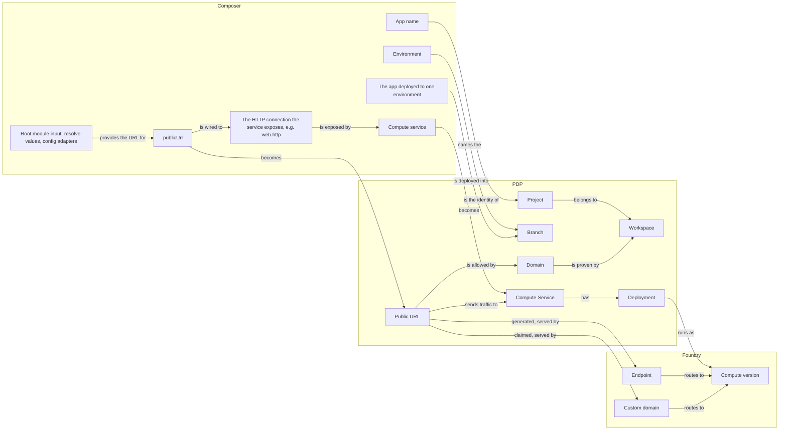

# Domain map: public URLs in Composer, PDP and Foundry

Working draft. It lists the things each system models, what each one is, and how the three systems correspond. Entities that don't exist yet are marked as new in the tables.

## Foundry: runs code and routes traffic to it

| Entity | What it is |
| --- | --- |
| **Compute version** (`cv_…`) | One copy of a service's code that Foundry can start, stop and report on. Foundry has no idea of a service; every other Foundry record points at a compute version. |
| **Endpoint** | A record that sends traffic for one `*.prisma.build` hostname to one compute version. PDP creates one per service, named after the service's id, and points it at the newly live compute version on every promote. |
| **Custom domain** (`dom_…`) | A record that sends traffic for one hostname, such as `www.example.com`, to one compute version, with the state of its certificate. Foundry only creates it if the hostname's DNS already points at Foundry. Deleting the compute version deletes the record. |

## PDP: the product's model

Exists today:

| Entity | What it is |
| --- | --- |
| **Project** | One application. Composer finds it by its `logicalId`. |
| **Branch** | One environment of one Project, so one app in one environment. It holds that environment's services, databases, buckets, configuration and deploy state. Every Project has one default Branch, created as `main`. |
| **Compute Service** (labelled App in PDP's code, API and Console) | A deployed service. It knows its `*.prisma.build` hostname and which of its deployments is live. |
| **Deployment** | One deployed copy of a service's code. It records which Foundry compute version runs it. Composer only creates a new one when the service's code or configuration changed. |
| **Build**, **Promotion** | One deploy run, and the moment a deployment became live. |
| **Database**, **Bucket**, **ConfigVariable** | Data, file storage, and per-Branch configuration values. |
| **ApplicationTopology** | A record, written on each deploy, of the graph that deploy declared. It is for display only; nothing is deployed from it. |

PDP has no record of custom domains today. They exist only in Foundry. To add one, the user must publish a TXT record proving they own the hostname (prisma/pdp-control-plane#5785) and point the hostname's DNS at Foundry.

New:

| Entity | What it is |
| --- | --- |
| **Public URL** | A URL on one Branch that receives traffic and sends it to one service, whichever of the service's deployments is live. Its URL is either one the user names or one the platform generates. It exists as soon as it's declared. Until its URL is allowed (see Domain) and its DNS is set up, it receives no traffic, but the deploy still succeeds. It survives its service being deleted. Composer finds it by its `logicalId`. |
| **Domain** | A domain a workspace has proven it owns. Today's ownership proof already works this way: the user publishes a TXT record carrying a value specific to their workspace (prisma/pdp-control-plane#5785), so the proof is per workspace and shared by every project in it. The user proves ownership on the platform; Composer has no part in it. A Public URL with a named hostname starts receiving traffic once the hostname is under a proven Domain. The platform owns `prisma.build` itself, so generated URLs need no proof. |

## Composer: how authors describe the app

| Entity | What it is |
| --- | --- |
| **App name** | The root module's name. It identifies the app in every environment, and it is the Project's `logicalId`. |
| **The app, deployed to one environment** | Everything under the root module, deployed into one environment. There is one of these per environment, so it is not the Project. |
| **Environment** (renamed from stage) | A place the app runs, such as `production`, `staging`, `pr-42`, or `dev` on your machine. Every environment has a name. `prisma deploy` uses `production` unless told otherwise; `prisma dev` uses `dev`. |
| **Compute service** and its **exposed HTTP connection** | A service, and the HTTP connection it offers to the rest of the graph with `expose: { http: rawHttpContract }`. Anything wired to that connection can send HTTP requests to the service. Other code refers to it as `web.http`. |
| **Node address** | A node's identity, such as `shop.site`. Composer writes it as the `logicalId` of the node's platform record. |
| **publicUrl** (new) | `publicUrl({ name, url, target })` sends public traffic to one service. `target` is wired to the HTTP connection the service exposes, which is how the URL knows which service receives its requests. `url` either names the hostname to use or asks the platform to generate one. It can differ per environment or derive from an input: `url` may be a `resolve()` value, computed after the graph is built from named inputs and the environment's name. |
| **Root module input** and **config adapters** (new) | Every module declares its inputs with one schema. The root module's inputs are filled by adapters listed in `prisma.config.ts`, for the environment being deployed. |

## How they correspond

| Composer | PDP | Foundry |
| --- | --- | --- |
| App name | the Project, as its `logicalId` | — |
| The app, deployed to one environment | that environment's Branch | — |
| A deploy to `production` | goes into the Project's default Branch (created as `main`) | — |
| A deploy to any other environment, such as `staging` | goes into the Branch named `staging`, which is created if it doesn't exist | — |
| A run of `prisma dev` | nothing; it runs on your machine | nothing |
| Compute service | a Compute Service, with a new Deployment whenever its code or configuration changed | one compute version per Deployment, plus the service's Endpoint |
| `publicUrl` with a generated URL | a Public URL that uses the service's existing `*.prisma.build` hostname | the service's Endpoint |
| `publicUrl` with a named hostname | a Public URL that needs a proven Domain | a Custom domain |
| Root module input and config adapters | nothing; Composer works out their values before deploying | nothing |

Each time a deployment goes live, PDP points the Foundry records behind every Public URL at that deployment's compute version.

## A named URL can belong to only one Public URL

If two Public URLs name the same hostname, traffic goes to whichever one Foundry's records happen to match. So a named hostname can belong to only one Public URL: across all environments of a project, and across all projects that share the Domain.

PDP has to refuse the second claim when the Public URL is created. Today Foundry refuses a hostname that's already registered, but only at the moment the hostname is attached to routing. Once Public URLs exist before their DNS is set up, two of them could both wait for DNS, and whichever connected first would win.

Generated URLs can't clash, because the platform makes each one unique. Composer can only spot a duplicate inside one deploy of one app; only the platform can check across environments and projects.

## Not yet settled

- Whether a workspace-level Domain is enough, or a project needs to be able to own a domain on its own; and whether proving ownership of `example.com` also covers names such as `preview.example.com`.
- Whether Foundry could send a hostname's traffic to a service, instead of to one compute version at a time.
- What a deploy does when its Public URL names a hostname another Public URL already holds.
