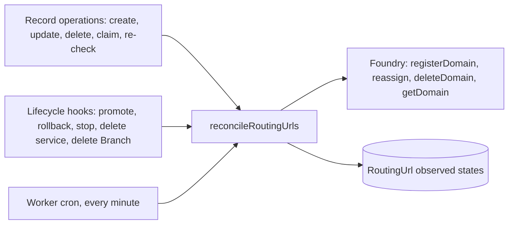

# Routing URLs — operations and lifecycle hooks

What changes a RoutingUrl's conditions, who notices, and what reaches Foundry. Companion to [RoutingUrls.md](platform-routing-urls.md), which holds the records and rules, and [ADR 015](https://github.com/prisma/pdp-control-plane/blob/chore/adr-ingress-entity/docs/architecture/adrs/ADR-015-routing-urls-and-domain-ownership.md). Function names are today's, in `packages/interactors/src/compute/` and `packages/interactors/src/branch/`.

## The one rule

Every path ends in the same place: `reconcileRoutingUrls(projectId)`, an interactor that evaluates each live row of the project and makes Foundry match. Inline hooks call it after their own work; the Worker's cron calls it every minute; the Management API's re-check routes call it. Nothing else talks to Foundry about domains. It runs under the project row lock that domain registration already takes, so two runs for one project never overlap.

## Operations on the records

| Operation | Route | Writes | Conditions it can change | Then |
| --- | --- | --- | --- | --- |
| Create a RoutingUrl | `POST /v1/services/{id}/urls` | row with `hostname` (canonical), `appId`, optional `logicalId`; no Foundry call | all six computed on first read | reconcile |
| Change hostname | `PATCH /v1/urls/{id}` | `hostname`; clears the three observed states | DNS, certificate, routing bound reset; ownership re-read for the new hostname | reconcile removes the old registration, then treats the row as new |
| Change service | `PATCH /v1/urls/{id}` | `appId` (same Branch only) | service present, live version, DNS (region may differ) | reconcile re-points or re-registers |
| Set `logicalId` | `PATCH /v1/urls/{id}` | `logicalId` | none | nothing |
| Delete a RoutingUrl | `DELETE /v1/urls/{id}` | `deletedAt` | row leaves the set | reconcile removes its registration, or hands it to a waiting row for the same hostname and service |
| Claim a domain | `POST /v1/workspaces/{id}/domains` | DomainOwnership with `verifiedAt` null; re-verifies other workspaces' verified claims that cover the domain | ownership verified, on every row the claims cover, in both workspaces | reconcile every affected project |
| Re-check a claim | `POST /v1/workspaces/{id}/domains/{id}/verify` | `verifiedAt` set or cleared from the TXT lookup | ownership verified on every row it covers | reconcile every affected project |
| Delete a claim | `DELETE /v1/workspaces/{id}/domains/{id}` | `deletedAt` | ownership verified goes false on rows no other claim covers | reconcile removes their registrations |

## Platform lifecycle hooks

| Event | Today's code | What changes for a row | Inline work | Then |
| --- | --- | --- | --- | --- |
| Service created | `createApp` | nothing; no row exists yet | none | nothing |
| Version promoted | `promoteApp` → `upsertEndpoint`, `reassignDomains` | live version changes | re-point every registered row of the service to the new Foundry version; on failure write it to the row, do not fail the promote | reconcile repairs what failed |
| Version rolled back | `rollbackApp` | same as promote | same | same |
| Live deployment stopped | `stopDeployment` → `moveDomainsToLiveDeployment`, `unbindEndpointIfBound` | live version becomes none, or another | if another is live, re-point; otherwise leave Foundry's registration where it is and mark routing bound false | reconcile keeps the registration (the service still exists) and re-points once a version is live again |
| Deployment deleted | `deleteDeployment` | as stopped, and Foundry deletes the version's domain rows | mark routing bound false; clear `foundryDomainId` if it pointed at that version; keep `registeredAt` | reconcile re-registers once a version is live, keeping the hostname |
| Service updated (region) | `updateApp` | DNS condition's target switchboard changes | none | reconcile re-evaluates DNS and re-registers in the new region |
| Service deleted | `deleteApp` | `appId` null on its rows; service present and live version go false | remove each row's registration | nothing until a deploy points the row at a new service |
| Branch deleted | `deleteBranch`, `tearDownBranchByGitName` | rows soft-deleted | remove registrations | nothing |
| Project or workspace deleted | through Branch deletion | as above | as above | nothing |
| Branch cleanup cron | `BranchCleanup.md` rule | reads live rows of the Branch to decide retention | none | nothing |

## Observed changes, seen only by the reconciler

| Change | How it is seen | Effect |
| --- | --- | --- |
| CNAME or address records appear or change | DNS lookup, `resolveCnameTarget` logic moved into the reconciler | DNS condition; registration can proceed |
| Certificate issued | `getDomain` reports `active` | certificate condition; row becomes serving |
| Certificate stuck | `getDomain` reports `provisioning` past Foundry's issuance timeout | delete and re-register |
| Foundry row gone or bound elsewhere | `getDomain` 404, or bound to a version that is not live | routing bound false; re-register or re-point |
| Another row released the hostname | the registered row for the hostname was deleted or re-pointed | routing bound can become true for a waiting row |
| Foundry rate limit | 429 | back off; leave the row for the next run |

## What the reconciler does per row

1. Read the row, its service, the service's live version, and the claims covering its hostname. Compute ownership verified, service present, live version.
2. If the service is gone (`appId` null, or the row or its Branch deleted): if the row has a registration, remove it, unless a waiting row for the same hostname and service exists, in which case hand it over; clear `registeredAt`; stop. If ownership is unverified: remove the registration the same way; stop. If the service exists but has no live version: keep the registration, write routing bound false, stop.
3. Check DNS. Write `dnsCheckedAt`. If DNS does not point at the service's region: stop. Do not call Foundry.
4. "Holding the registration" means `registeredAt` is set; `foundryDomainId` says whether Foundry currently has the row. If `registeredAt` is null: set it in the database. The partial unique index on `hostname` over live rows with `registeredAt` set makes this the platform-wide check; on a unique-constraint violation write routing bound false with the id of the row that holds the registration, which the read route shows as that row's workspace, project and service to a caller with access to that workspace and as "held by another workspace" otherwise; stop. Then `registerDomain` against the live version and store `foundryDomainId`. On any response other than success, including a 400, clear `registeredAt` so the row holds nothing; a 400 is also written to the row as "DNS not ready". If `registeredAt` is set but `foundryDomainId` is null (Foundry's row was deleted with its version): `registerDomain` again and store the new id, keeping the marker. Foundry's own per-region refusal of a duplicate is the safety net.
   A row with `foundryDomainId` set and `registeredAt` null is a registration the backfill found but could not give the hostname to (see RoutingUrls.md, "Existing domains"); the reconciler leaves its Foundry row alone and reports "hostname in use" until an operator resolves it.
5. If the row's registration points at a version that is not live: `reassign` it.
6. Read the certificate state; write `certificateIssuedAt` when active. If `provisioning` past the timeout: delete and re-register.
7. When this row holds the registration and it points at the live version: write `routingBoundAt`. The certificate is its own condition; the row serves traffic only when both hold.

A change that leaves Foundry's table the same, such as a row being replaced by another row for the same hostname and service, never deletes the registration or the certificate. In report-only mode the reconciler writes the observed states and logs the Foundry calls it would make without making them.

## What stops being inline

`createCustomDomain` stops calling Foundry and stops checking TXT; it creates a row. `retryCustomDomain` becomes a re-check that triggers reconcile. `deleteCustomDomain` deletes the row. `reassignDomains` stays as promote's inline step but writes failures to the row. `verifyCustomDomainOwnership` becomes the claim's verification, called by claim, re-check, the reconciler for unverified claims, and conflict re-verification.
