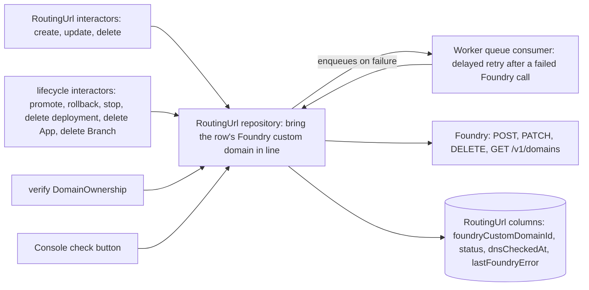

# Routing URLs — operations and lifecycle

What changes a RoutingUrl's conditions, who notices, and what reaches Foundry. Companion to [RoutingUrls.md](platform-routing-urls.md), which holds the records and rules, and [ADR 015](https://github.com/prisma/pdp-control-plane/blob/chore/adr-ingress-entity/docs/architecture/adrs/ADR-015-routing-urls-and-domain-ownership.md). Function names are today's, in `packages/interactors/src/compute/` and `packages/interactors/src/branch/`.

## One operation behind the repository

The RoutingUrl repository has one operation that takes a row, computes its six conditions, and makes the Foundry call the row needs, if any. It is the first place the control plane keeps a system below it consistent the way [the proposal for keeping the data plane consistent with the control plane](https://github.com/prisma/pdp-control-plane/blob/chore/adr-ingress-entity/docs/data-plane-consistency/README.md) describes, and that document works the RoutingUrl through as its example. Every path that can change a condition ends by calling it: the interactors that write RoutingUrls, the lifecycle interactors that change a service's live deployment or delete a service or Branch, the Management API's verify route, the Console's check button, and the Worker queue consumer that retries a failed Foundry call. None of the callers knows what it does. It is the only code that creates, reassigns or deletes a Foundry custom domain.

## Operations on the records

| Operation | Route | Interactor | Writes | Then |
| --- | --- | --- | --- | --- |
| Create a RoutingUrl | `POST /v1/services/{id}/urls` | create | row with canonical `hostname`, `appId`, optional `logicalId`; no Foundry call | repository operation on the row |
| Update a RoutingUrl: hostname, service, `logicalId` | `PATCH /v1/urls/{id}` | update | the changed columns. A new hostname clears the Foundry columns; the old custom domain is deleted | repository operation on the row |
| Delete a RoutingUrl | `DELETE /v1/urls/{id}` | delete | `deletedAt` | the custom domain is deleted, or moved to a waiting row for the same hostname and service |
| Read a RoutingUrl | `GET /v1/urls/{id}`, the list routes | none; a route over the repository | nothing | nothing |
| Claim a domain | `POST /v1/workspaces/{id}/domains` | create DomainOwnership | row with `verifiedAt` null | verify runs once at once, and other workspaces' verified claims covering the domain are re-verified |
| Verify a claim | `POST /v1/workspaces/{id}/domains/{id}/verify` | verify DomainOwnership | `verifiedAt` set or cleared from the TXT lookup | repository operation on every RoutingUrl the claim covers |
| Delete a claim | `DELETE /v1/workspaces/{id}/domains/{id}` | delete DomainOwnership | `deletedAt` | repository operation on every RoutingUrl no other claim covers; their custom domains are deleted |

## Lifecycle events that reach a RoutingUrl

| Event | Today's interactor | What changes for a row | What the repository operation does |
| --- | --- | --- | --- |
| Service created | `createApp` | nothing; no row exists yet | nothing |
| Deployment promoted | `promoteApp` → `upsertEndpoint`, `reassignDomains` | the live deployment changes | `PATCH /v1/domains/{id}` to the new compute version for each row of the service; a failure is written to `lastFoundryError` and the promote still succeeds |
| Service rolled back | `rollbackApp` | same as promote | same |
| Live deployment stopped | `stopDeployment` → `moveDomainsToLiveDeployment`, `unbindEndpointIfBound` | no deployment is live, or another is | if another is live, reassign; otherwise leave the custom domain bound to the stopped compute version and report "custom domain bound" as unmet |
| Deployment deleted | `deleteDeployment` | Foundry deletes the compute version's custom domains | clear `foundryCustomDomainId`, `foundryIssuanceStartedAt` and the status columns on rows bound to it; create the custom domain again once a deployment is live |
| Service region changed | `updateApp` | the switchboard the DNS must point at changes | delete the custom domain in the old region; the row goes through DNS and creation again in the new one |
| Service deleted | `deleteApp` | `appId` null on its rows | delete each row's custom domain |
| Branch deleted | `deleteBranch`, `tearDownBranchByGitName` | rows soft-deleted | delete their custom domains |
| Project or workspace deleted | through Branch deletion | as above | as above |
| Branch cleanup cron | `BranchCleanup.md` rule | reads live rows of the Branch to decide retention | nothing |

## Facts the control plane learns only by looking

| Fact | How it is looked up | What changes |
| --- | --- | --- |
| The hostname's CNAME or address records point at the switchboard, or stopped doing so | DNS lookup, today's `resolveCnameTarget` logic | `dnsCheckedAt`; the custom domain can be created |
| The custom domain's status | `GET /v1/domains/{id}` | `foundryCustomDomainStatus` and the failure reason; `active` means the certificate is issued |
| The custom domain is gone | `GET /v1/domains/{id}` returns 404 | `foundryCustomDomainId`, `foundryIssuanceStartedAt` and the status columns cleared; created again once a deployment is live |

Both are looked up when the repository operation runs: on every write to the row, on every lifecycle event that reaches it, and when the user presses the check button in the Console, which issues an update of the row with no changes and so runs the operation like every write. A cron that runs the operation for every row not yet serving, so the button is never needed, is a stretch goal at the end of the project.

## What the repository operation does for one row

1. Read the row, its service, the service's live deployment, and the live DomainOwnership rows covering its hostname. Compute ownership verified, service present and live deployment.
2. If the service is gone, or the row or its Branch is deleted, or ownership is unverified: delete the row's custom domain if it has one, unless another live row names the same hostname on the same service, in which case move the custom domain id, `foundryIssuanceStartedAt` and the status columns to that row. Clear the Foundry columns on this one. If this run deleted or moved a custom domain, run these steps once for each other live row that names the same hostname, since one of them may now be able to create its own; that nested run does not fan out again. Stop.
3. If the service exists but no deployment is live: leave the custom domain as it is and stop. The row reports "custom domain bound" as unmet.
4. Look up DNS and write `dnsCheckedAt`. If DNS does not point at the service's regional switchboard: stop. Do not call Foundry.
5. If the row has no custom domain: take the advisory lock for the hostname. If another live row already has a custom domain for the hostname, release the lock and stop; the row reports the hostname as in use and who holds it. Otherwise `POST /v1/domains { domain, computeVersionId }`, store the id and set `foundryIssuanceStartedAt`, release the lock. On any failure write `lastFoundryError`; Foundry's 400 for DNS is written as "DNS not ready".
6. If the row has a custom domain bound to a compute version other than the live deployment's: `PATCH /v1/domains/{id}` to the live one.
7. `GET /v1/domains/{id}` and write the status and failure reason. A 404 means the custom domain is gone: clear the id, `foundryIssuanceStartedAt` and the status columns, and go back to step 5 once in this run, so it is created again at once; a second 404 in the same run is a failure for step 9. If the status is `failed` with a DNS failure reason and step 4 passed, `POST /v1/domains/{id}/retry` and set `foundryIssuanceStartedAt` again; any other failure waits for the user's retry in the Console.
8. Clear `lastFoundryError` on success.

9. If any Foundry call in these steps failed, or the custom domain's status is `provisioning`: enqueue a delayed message for the row on a Worker queue. The consumer runs these same steps. For a failed call it re-enqueues with backoff up to a bounded number of attempts; after the last, the failure stays on the row and the alert in NFR4 of the platform spec, `projects/routing-urls/spec.md` in prisma/pdp-control-plane fires. For `provisioning` with no failed call in the run, it re-enqueues at a fixed interval for as long as Foundry's own issuance timeout; if the status is still `provisioning` after that, the row is written as stuck and NFR4's second alert, for a stuck certificate, fires. When a run has both a failed call and a `provisioning` status, the failed-call policy applies to that run, and once a run succeeds the `provisioning` policy takes over with its clock counted from `foundryIssuanceStartedAt`, the start of the current issuance attempt, not from the recovery. A `provisioning` status is a transient state the control plane's own call put Foundry in, so following it up is the control plane's job, not the user's: once the certificate is active the row serves with no further press.

The verify route, the check button, the lifecycle interactors and the retry consumer all call these same steps. The retry consumer can run in a report-only mode that logs the Foundry calls it would make without making them.

## What stops being inline

`createCustomDomain` stops calling Foundry and stops checking TXT; it becomes the create interactor. `retryCustomDomain` becomes the verify route plus the repository operation. `deleteCustomDomain` becomes the delete interactor. `reassignDomains` becomes promote's call into the repository operation, with failures written to the row. `verifyCustomDomainOwnership` becomes the verify interactor, called by claim, by the verify route, and by conflict re-verification.
