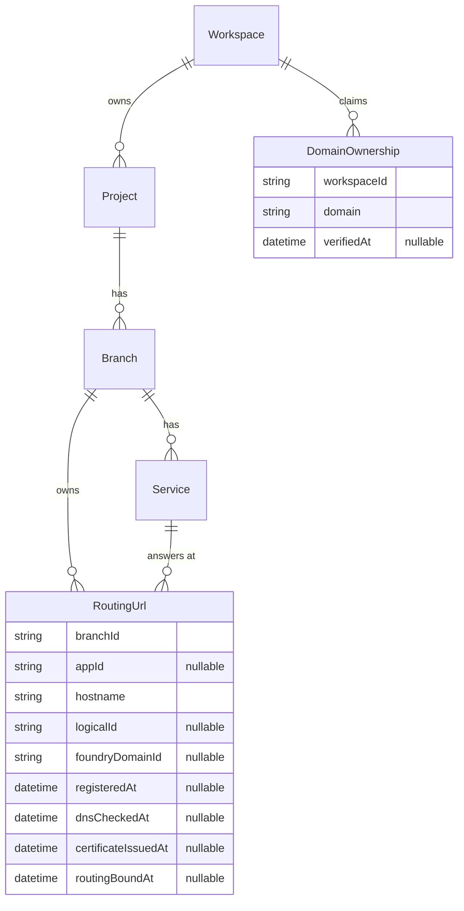

# Routing URLs and domain ownership

The design for custom hostnames on Compute: the two records the control plane owns, the rules they follow, what the Console shows, and the step that follows. The decision and its alternatives are in [ADR 015](https://github.com/prisma/pdp-control-plane/blob/chore/adr-ingress-entity/docs/architecture/adrs/ADR-015-routing-urls-and-domain-ownership.md). How each operation and lifecycle event moves the records is in [RoutingUrlLifecycle.md](platform-routing-url-lifecycle.md). The project that builds it is `projects/routing-urls/`.

## Words used

- A **service** is a Compute service. In code and in the database its model is still called `App`, and columns that point at one are called `appId`.
- A **version** is one deployed build of a service. The **live version** is the one receiving traffic. Promote, rollback, stop and delete change which version is live.
- **Foundry** is the routing layer. It terminates TLS and routes a hostname to a version. Its domain registration refuses a hostname until the hostname's DNS points at Foundry's regional entry point, the **switchboard** (for example `switchboard.cdg.prisma.build`), and it only routes a hostname once its certificate is issued. It identifies a registration by an id it assigns (`dom_…`) and has no lookup by hostname.
- The **endpoint** is the hostname Foundry gives every service on `prisma.build`, such as `svc_123.cdg.prisma.build`. It is created at promote and stored on the service as `endpointDomain`. The first step of this design leaves it as it is.

## The records

### RoutingUrl

A row is one hostname and the service it reaches.

| Column | Meaning |
| --- | --- |
| `branchId` | the Branch that owns the row's lifetime, also while `appId` is null |
| `appId` | the service the hostname reaches; null after the service is deleted |
| `hostname` | canonical: lowercase, no trailing dot, IDN labels in punycode |
| `logicalId` | a deploy tool's own identifier for the row; Composer writes the node's address. Null for rows made in the Console or by the backfill |
| `foundryDomainId` | the id Foundry assigned when the hostname was registered; null until then, and again if Foundry's row is deleted with its version |
| `registeredAt` | set while this row holds the hostname's registration; the platform-wide uniqueness check is a partial unique index on `hostname` over live rows with this set |
| `dnsCheckedAt`, `certificateIssuedAt`, `routingBoundAt` | when each observed condition was last seen true; null when it is not |

How the hostname was chosen is part of the operation that created the row, not a column. A service may have any number of rows. Rows are soft-deleted like the other models.

### DomainOwnership

A row is a workspace's claim to one domain, verified or not.

| Column | Meaning |
| --- | --- |
| `workspaceId` | the workspace that holds the claim |
| `domain` | an exact hostname (`shop.com`) or an exact wildcard with one leading `*.` label (`*.preview.shop.com`), canonical as above |
| `verifiedAt` | when the TXT record was last seen carrying the workspace's value; null while unverified |

One live row per workspace and domain.

## The conditions

A RoutingUrl serves traffic only when all six conditions hold. Each can become true or false on its own and in any order, which is why the row has no single status.

| Condition | Meaning | Source |
| --- | --- | --- |
| ownership verified | a verified DomainOwnership claim in the workspace covers the hostname: equals it, or is a wildcard exactly one label above it | the DomainOwnership table, read when the row is served |
| service present | `appId` points at a service that exists | the service table |
| live version | that service has a live version | the deployment tables |
| DNS points at region | the hostname's first CNAME target is the regional switchboard, or its address records resolve to it (Cloudflare-flattened apex domains) | observed; `dnsCheckedAt` |
| certificate issued | Foundry reports the hostname's certificate as active | observed; `certificateIssuedAt` |
| routing bound | this row holds the registration and Foundry's row points at the live version | observed; `registeredAt`, `routingBoundAt` |

The row reports every condition and the first unmet one as the next thing the user has to do, with the exact DNS record to publish. When the unmet condition is that another row holds the hostname's registration, the report names that row's workspace, project and service to a caller who can access that workspace, and says "held by another workspace" to one who cannot.

## The rules

**Nothing is created on its own.** A deploy tool creates a RoutingUrl for each hostname its code declares. A Console user creates one on the service's page. The platform creates none.

**A row exists before its DNS does.** Creating one stores the record and calls no Foundry API. The conditions say what is missing.

**One hostname is served by one row.** Any number of rows may name a hostname; creating one never fails on that account. At most one row on the whole platform holds the registration, enforced by the index on `registeredAt`. A row that cannot take the registration reports the hostname as in use, as above. The hostname passes to another row only when the holder is deleted or re-pointed. This is about traffic, not ownership: it stops two services receiving the same requests.

**Ownership is a claim, verified by the workspace's TXT record.** Verification is the check the platform already does: `_prisma-verification.<domain>` (for a wildcard, at its base domain) must carry `prisma-verification=<hash of the workspace id>`. A claim is created unverified with the record to publish; a re-check route and the reconciler set `verifiedAt` when the record resolves. When a workspace claims a domain that another workspace's verified claim covers, the existing claims are re-verified first; one whose record is gone becomes unverified and every RoutingUrl relying on it reports "ownership not verified". Two workspaces can hold verified claims for one domain; which service a hostname reaches is decided by the registration rule, not by ownership. Claims are not re-verified on a schedule.

**The claim belongs to the workspace** because the TXT value is a hash of the workspace id and nothing smaller. Claiming `shop.com` says nothing about `www.shop.com`; a wildcard covers one label: `pr-42.preview.shop.com` but not `a.b.preview.shop.com`. This is the convention of Cloudflare, AWS Certificate Manager, Azure and ACME. Either order works: claim in the Console first, or deploy first and follow the row's setup link.

**The control plane keeps Foundry in step.** The RoutingUrl is the source of truth; Foundry's registration is derived from it. Inline hooks do what they can and write failures to the row; a reconciler repairs the rest. Details in [RoutingUrlLifecycle.md](platform-routing-url-lifecycle.md).

**A routing no-op never touches a certificate.** When one row replaces another for the same hostname and service, the registration is handed over, not deleted and recreated.

**A row survives its service.** Deleting the service sets `appId` to null and releases the registration; the hostname, its DNS and its claim stay, and the next deploy that declares the hostname points the row at the new service. A service that merely has no live version keeps its registrations. A row is deleted when its Branch is deleted (also through project or workspace deletion) or when a user or deploy tool deletes it.

**A deploy finds its row by `logicalId`**, looked up by Branch. The platform never resolves anything by it. Changing a row's hostname or service updates the same row.

## Management API

| Route | Purpose |
| --- | --- |
| `POST /v1/services/{id}/urls`, `GET /v1/services/{id}/urls` | create and list a service's rows |
| `GET`, `PATCH`, `DELETE /v1/urls/{id}` | read with conditions; change hostname, service (same Branch) or `logicalId`; delete |
| `GET /v1/projects/{id}/branches/{id}/urls?logicalId=` | a Branch's rows, filtered for deploy tools |
| `POST`, `GET /v1/workspaces/{id}/domains`; `GET`, `DELETE /v1/workspaces/{id}/domains/{id}`; `POST …/verify` | claim, list, read, delete, re-check |

Responses carry the six conditions and the Console setup link while any is unmet. The existing `/v1/services/{id}/domains` and `/v1/domains/{id}` routes become a view over RoutingUrls for one deprecation cycle. The Alchemy Prisma provider gains a `Prisma.RoutingUrl` resource over these routes, replacing `Prisma.CustomDomain` for Composer.

## Console

The service page's Domains section lists the service's RoutingUrl rows: hostname, conditions met, the next thing to do with the record to copy, and the holder of a contested hostname where the viewer may see it. Adding a domain creates a row; removing one is a double-confirmed dangerous action. The endpoint is shown where it is today.

Workspace settings gains a Domains page: the workspace's claims, each with its TXT record and whether it is verified, with claim, re-check and delete.

## Existing domains

Every Foundry custom domain becomes a RoutingUrl on the service owning its version, carrying its Foundry id and holding the registration, with no `logicalId`, and its workspace gets a verified claim for the hostname, because the platform verified the TXT record when the domain was created; the backfill does not look it up again. Foundry lists domains per compute version, so the backfill walks the live versions. Where Foundry holds one hostname in two regions, the oldest row holds the registration and the other is recorded for an operator. Existing users see no change.

Branch cleanup's rule that retains a Branch with a custom domain reads RoutingUrl rows instead of Foundry; the rule is no longer needed and its removal is separate work.

## The next step: the endpoint as a RoutingUrl

Today every service is reachable at its endpoint whether or not anyone meant it to be. The next step of this design makes the endpoint an opt-in RoutingUrl, created like any other through an operation that takes the hostname from the service, so that a service nothing should reach from outside has no public hostname. The row it produces looks like every other row. The scenarios that step has to satisfy are recorded in the Composer repository at `docs/design/05-prisma-cloud/public-urls/step-two-migration-scenarios.md`. A deploy tool whose older versions never knew about routing records takes ownership of the rows that exist on its own side: Composer's Alchemy resource finds a live row on the same service with the same hostname and no `logicalId`, writes its `logicalId` on it through the update route, and records it. The platform writes no `logicalId` and derives none; it only lets an update set it, which it already does. Private routing in Foundry is outside this design; the entity gains what it needs when that exists.
