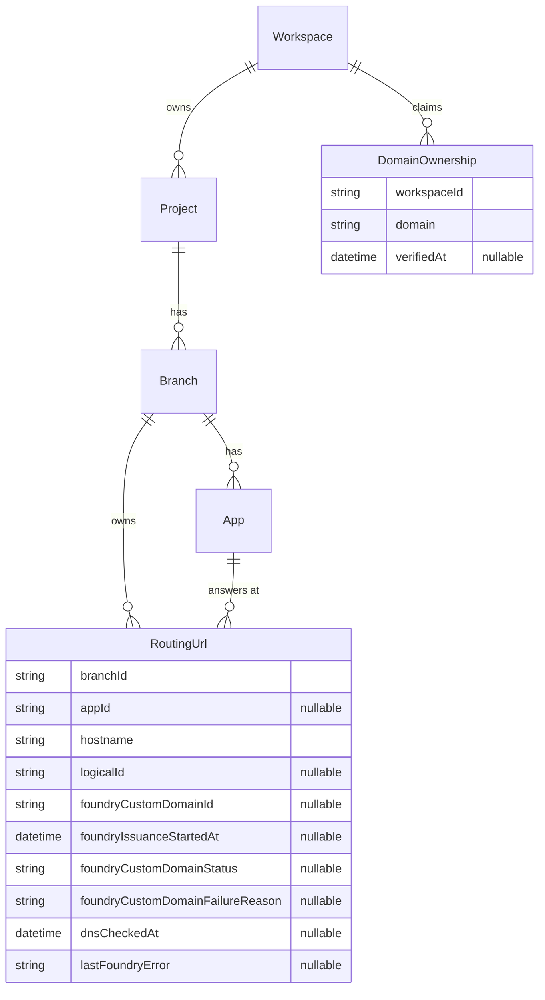

# Routing URLs and domain ownership

The design for custom hostnames on Compute: the two records the control plane owns, the rules they follow, how the control plane keeps Foundry consistent with them, and what the Console shows. The decision and its alternatives are in [ADR 015](https://github.com/prisma/pdp-control-plane/blob/chore/adr-ingress-entity/docs/architecture/adrs/ADR-015-routing-urls-and-domain-ownership.md). How each operation and lifecycle event moves the records is in [RoutingUrlLifecycle.md](platform-routing-url-lifecycle.md). The project that builds it is `projects/routing-urls/`.

## Words used

- A **service** is a Compute service. In code and in the database its model is `App`, and columns that point at one are `appId`.
- A **deployment** is one deployed build of a service. Its code runs in Foundry as a **compute version**, whose id the Deployment row stores as `foundryVersionId`. The **live deployment** is the one receiving traffic. Promote, rollback, stop and delete change which deployment is live.
- **Foundry** is the service in pdp-metal that runs compute versions and owns two registries: the **endpoint** registry, which maps a `prisma.build` prefix to a compute version, and the **custom domain** registry, which maps a customer hostname to a compute version and holds its certificate status. A custom domain has an id (`dom_…`) and a status: `provisioning`, `active` or `failed` with a failure reason. Foundry refuses to create a custom domain until the hostname's DNS points at the regional switchboard, and it issues the certificate asynchronously after creation.
- **Conduit** is the regional edge, reached at `switchboard.<region>.prisma.build`. It terminates TLS and routes each request by its Host header, reading Foundry's two registries.

## The records

### RoutingUrl

A row is one custom hostname and the service it reaches.

| Column | What it holds |
| --- | --- |
| `branchId` | the Branch that owns the row. The row lives as long as the Branch does, also while `appId` is null |
| `appId` | the service the hostname reaches. Null after the service is deleted; the row stays |
| `hostname` | the hostname in canonical form: lowercase, no trailing dot, international labels in punycode |
| `logicalId` | an identifier a deploy tool writes so it can find the row again. Composer writes the node's address. Null for rows made in the Console or by the backfill |
| `foundryCustomDomainId` | the id of the Foundry custom domain for this hostname, once the control plane has created it. Null before that, and null again when the deployment it was bound to is deleted, because Foundry deletes the custom domain with the compute version |
| `foundryIssuanceStartedAt` | when the current certificate issuance began: the custom domain's creation, or the most recent retry; the clock for how long issuance may take |
| `foundryCustomDomainStatus`, `foundryCustomDomainFailureReason` | Foundry's status and failure reason for the custom domain, as last read |
| `dnsCheckedAt` | when the hostname's DNS was last seen pointing at the regional switchboard; null if it was not |
| `lastFoundryError` | the error from the last Foundry call that failed, cleared by the next success |

How the hostname was chosen is part of the operation that created the row, not a column. A service may have any number of rows. Rows are soft-deleted like the other models.

### DomainOwnership

A row is a workspace's claim to one domain, verified or not.

| Column | What it holds |
| --- | --- |
| `workspaceId` | the workspace that holds the claim |
| `domain` | an exact hostname (`shop.com`) or an exact wildcard with one leading `*.` label (`*.preview.shop.com`), canonical as above |
| `verifiedAt` | when the TXT record was last seen carrying the workspace's value; null while unverified |

One live row per workspace and domain.

## The six conditions

A RoutingUrl serves traffic only when all six of these are true. Each can become true or false on its own and in any order, which is why the row has no single status.

| Condition | Meaning | Where it comes from |
| --- | --- | --- |
| ownership verified | a verified DomainOwnership in the workspace covers the hostname: equals it, or is a wildcard exactly one label above it | the DomainOwnership table, read when the row is served |
| service present | `appId` points at a service that exists | the App table |
| live deployment | that service has a live deployment | the Deployment table |
| DNS points at the switchboard | the hostname's first CNAME target is the regional switchboard, or its address records resolve to it (Cloudflare-flattened apex domains) | looked up; `dnsCheckedAt` |
| custom domain bound | a Foundry custom domain exists for the hostname, this row holds its id, and it is bound to the live deployment's compute version | `foundryCustomDomainId`, and the row's last Foundry call |
| certificate active | Foundry reports the custom domain's status as `active` | `foundryCustomDomainStatus` |

The row reports every condition and the first unmet one as the next thing the user has to do, with the exact DNS record to publish. When the unmet condition is that another row holds the hostname's custom domain, the report names that row's workspace, project and service to a caller who can access that workspace, and says "held by another workspace" to one who cannot.

## The rules

**Nothing is created on its own.** A deploy tool creates a RoutingUrl for each hostname its code declares. A Console user creates one on the service's page. The platform creates none.

**A row exists before its DNS does.** Creating one stores the record and calls nothing in Foundry. The conditions say what is missing.

**One row serves a hostname.** Any number of rows may name a hostname; creating one never fails on that account. At most one row on the whole platform holds a Foundry custom domain for a hostname, enforced by a unique index on `hostname` over live rows whose `foundryCustomDomainId` is set. Creating the custom domain takes a database advisory lock keyed by the hostname, so two rows in different regions cannot both create one at once. A row that cannot create one reports the hostname as in use, as above. The hostname passes to another row only when the holder's custom domain is deleted. This is about traffic, not ownership: it stops two services receiving the same requests.

**Ownership is a claim, verified by the workspace's TXT record.** Verification is the check the platform already does: `_prisma-verification.<domain>` (for a wildcard, at its base domain) must carry `prisma-verification=<hash of the workspace id>`. A claim is created unverified with the record to publish; verification sets `verifiedAt` when the record resolves. When a workspace claims a domain that another workspace's verified claim covers, the existing claims are re-verified first; one whose record is gone becomes unverified and every RoutingUrl relying on it reports "ownership not verified". Two workspaces can hold verified claims for one domain; which service a hostname reaches is decided by the custom-domain rule, not by ownership. Claims are not re-verified on a schedule.

**The claim belongs to the workspace** because the TXT value is a hash of the workspace id and nothing smaller. Claiming `shop.com` says nothing about `www.shop.com`; a wildcard covers one label: `pr-42.preview.shop.com` but not `a.b.preview.shop.com`. This is the convention of Cloudflare, AWS Certificate Manager, Azure and ACME. Either order works: claim in the Console first, or deploy first and follow the row's setup link.

**The RoutingUrl repository keeps Foundry consistent with the row.** The RoutingUrl is the source of truth. Whenever a row is written, or a service's live deployment changes, or a service or Branch is deleted, the repository computes the row's conditions and makes the Foundry call the row needs, if any, and records a failure on the row instead of dropping it. When Foundry reports the custom domain `failed` for a DNS reason and the control plane's own DNS check now passes, the repository calls Foundry's retry route; any other failure is left for the user's retry in the Console, as today. When a Foundry call fails, or leaves the custom domain in the transient `provisioning` state while its certificate is issued, the repository enqueues a delayed message for the row on a Worker queue; the consumer runs the same repository operation again, with backoff and a bounded number of attempts after a failure, and at a fixed interval for as long as Foundry's issuance timeout while a certificate is issuing, so a failed reassign at promote repairs itself and a certificate completes without the user pressing anything twice. When a row's custom domain is deleted, the operation also runs for every other live row naming the same hostname, so a waiting row in another workspace gets the hostname without anyone acting. The two facts nobody tells the control plane about, the hostname's DNS and the custom domain's certificate, are looked up when the row is written and when the user presses the check button in the Console, which runs the same operation. A Worker cron that runs the operation for every row not yet serving, so the button becomes unnecessary, is a stretch goal at the end of the project. Details in [RoutingUrlLifecycle.md](platform-routing-url-lifecycle.md).

**A change that leaves the routing table the same never touches a certificate.** When a row is deleted and another live row names the same hostname on the same service, the repository moves the custom domain id to that row instead of deleting the custom domain and creating it again.

**A row survives its service.** Deleting the service sets `appId` to null and deletes the custom domain; the hostname, its DNS and its claim stay, and the next deploy that declares the hostname points the row at the new service. Stopping a service's live deployment leaves the custom domain in place, bound to the stopped compute version, and the row reports "custom domain bound" as unmet until a deployment is live again. Deleting the live deployment deletes the custom domain with its compute version, so the repository clears `foundryCustomDomainId` in that operation and creates the custom domain again when a deployment is live. A row is deleted when its Branch is deleted (also through project or workspace deletion) or when a user or deploy tool deletes it.

**A deploy finds its row by `logicalId`**, looked up by Branch. The platform never resolves anything by it. Changing a row's hostname or service updates the same row.

## Management API

| Route | Purpose |
| --- | --- |
| `POST /v1/services/{id}/urls`, `GET /v1/services/{id}/urls` | create and list a service's rows |
| `GET`, `PATCH`, `DELETE /v1/urls/{id}` | read with conditions; change hostname, service (same Branch) or `logicalId`; delete |
| `GET /v1/projects/{id}/branches/{id}/urls?logicalId=` | a Branch's rows, filtered for deploy tools |
| `POST`, `GET /v1/workspaces/{id}/domains`; `GET`, `DELETE /v1/workspaces/{id}/domains/{id}`; `POST …/verify` | claim, list, read, delete, verify |

Mutations go through interactors: create, update and delete a RoutingUrl; create and delete a DomainOwnership; verify a DomainOwnership. Reads are routes over the repositories. Responses carry the six conditions and the Console setup link while any is unmet. The existing `/v1/services/{id}/domains` and `/v1/domains/{id}` routes become a view over RoutingUrls for one deprecation cycle. The Alchemy Prisma provider gains a `Prisma.RoutingUrl` resource over these routes, replacing `Prisma.CustomDomain` for Composer.

## Console

The service page's Domains section lists the service's RoutingUrl rows: hostname, conditions met, the next thing to do with the record to copy, and the holder of a contested hostname where the viewer may see it. Adding a domain creates a row; removing one is a double-confirmed dangerous action. The endpoint is shown where it is today.

Workspace settings gains a Domains page: the workspace's claims, each with its TXT record and whether it is verified, with claim, verify and delete.

## Existing custom domains

Every Foundry custom domain becomes a RoutingUrl on the service owning its compute version, carrying the custom domain's id, with no `logicalId`, and its workspace gets a verified claim for the hostname, because the platform verified the TXT record when the custom domain was created; the backfill does not look it up again. Foundry lists custom domains per compute version, so the backfill walks the live deployments. Where Foundry holds one hostname in two regions, the oldest row gets the custom domain id and the other is recorded for an operator. Existing users see no change.

Branch cleanup's rule that retains a Branch with a custom domain reads RoutingUrl rows instead of Foundry; the rule is no longer needed and its removal is separate work.

## The next step: the prisma.build hostname as a RoutingUrl

Today every service is reachable at its endpoint whether or not anyone meant it to be. The next step of this design makes the endpoint a RoutingUrl, created like any other through an operation that takes the hostname from the service, so that a service nothing should reach from outside has no public hostname. Such a row stores no Foundry id, because Foundry keys endpoints by their prefix, which the hostname contains. The scenarios that step has to satisfy are recorded in the Composer repository at `docs/design/05-prisma-cloud/public-urls/step-two-migration-scenarios.md`. A deploy tool whose older versions never knew about RoutingUrls takes ownership of the rows that exist on its own side: Composer's Alchemy resource finds a live row on the same service with the same hostname and no `logicalId`, writes its `logicalId` on it through the update route, and records it. The platform writes no `logicalId` and derives none. Private routing in Foundry is outside this design.
